<!-- AI-generated with GPT-6, 2026-10-17, reviewed by Haechan Jung -->
<!-- Changed: 추천 카드·저장된 추천 기능 추가 -->
<!-- AI-generated with GPT-6, 2026-10-18, reviewed by Haechan Jung -->
<!-- Changed: 화면 디자인 및 식사 흐름 개선 -->

<!-- AI-generated with GPT-6, 2026-11-02, reviewed by Seoyeon Heo -->
<!-- Changed: 음식 추천 대상 자동 선택 및 기존 카드가 있어도 대상 변경 지원 -->

<!-- AI-generated with GPT-6, 2026-11-13, reviewed by Haechan Jung -->
<!-- Changed: 거절 후 추가 추천 선택·대상 재사용 및 Skip 제거 명세 -->
<!-- AI-generated with GPT-6, 2026-11-18, reviewed by Haechan Jung -->
<!-- Changed: 시도 기록을 보존하는 저장 목록 제거와 대기 상태 정의 -->
<!-- AI-generated with GPT-6, 2026-11-26, reviewed by Haechan Jung -->
<!-- Changed: 홈 추천 생성·재생성 한도, 카드 결정·되돌리기와 새 식사 체크인 연결 -->

# D — 추천 및 저장된 추천

보호자는 홈에서 현재 아이를 위한 추천 하나를 요청한다. 앱은 아이의 프로필과 지금까지 저장한 식사 기록을 바탕으로 다음 식사에서 시도할 작은 변화와 그 이유를 설명한다. 보호자는 추천을 저장하거나, 추천으로 새 식사 체크인을 시작하거나, 추천을 제외할 수 있다.

기능 기준은 [노션 5.0 §5.6 · I2-US-15~19](https://www.notion.so/420582b3bbeb801e9a66c2e42f7f4c6f#4c1582b3bbeb83ac82390168f919eda1)과 [§7.4 추천과 시도 기록](https://www.notion.so/420582b3bbeb801e9a66c2e42f7f4c6f#4b8582b3bbeb821a8a3981694d99ea29)이다. 화면은 [Figma Iteration 5](https://www.figma.com/design/mxsRk3PMmZGuNpJVeAiRi5/?node-id=1206-15)를 따른다.

## 홈에서 추천 받기

### 진입과 생성

1. 보호자는 홈의 `Get a suggestion`으로 현재 아이의 추천을 요청한다. [홈 명세](../home/spec.md) · [홈 디자인](https://www.figma.com/design/mxsRk3PMmZGuNpJVeAiRi5/?node-id=1218-2)
2. 앱은 알레르기 질문의 명시적 응답과 추천의 근거로 쓸 수 있는 저장 식사 기록을 확인한다. ‘알려진 알레르기 없음’은 유효한 응답이다. 알레르기 응답이 없거나 사용할 기록이 없으면 홈에서 어떤 정보가 필요한지 알린다. 개인화에 충분한 기록을 판단하는 세부 기준은 노션 I3-OD-05에서 열어 두고 있다.
3. 조건을 충족하면 앱은 추천 화면을 열고 한 장을 요청한다. 추천에는 현재 아이의 알레르기·식사 방식(Dietary Pattern)·거부한 음식과 그 조리법 및 이유·감각 특성, 누적 식사 기록, 이전 추천을 사용한다. 안전성 확인과 근거 선택은 [추천 정책](../../../server/docs/recommendation-policy.md)을 따른다.
4. 홈 열기·새로고침, 체크인 저장, 식후 리뷰 저장·수정, 식사 상세 열기는 생성을 시작하지 않는다. 보호자가 다음에 홈에서 요청하면 최신 프로필과 저장 기록을 쓴다. 미처리 추천이 남아도 홈에 식사별 이어보기 카드를 만들지 않는다.

### 추천 화면의 상태

| 상태 | 보호자에게 보이는 내용과 동작 |
| --- | --- |
| 생성 중 | 현재 아이의 프로필과 식사 기록으로 추천을 준비하고 있다는 안내를 표시한다. 연속 탭은 한 번만 요청한다. 보호자가 `Back to Home`으로 나가거나 앱을 닫아도 추천의 저장·제외·시도 기록이 생기지 않는다. [생성 중 디자인](https://www.figma.com/design/mxsRk3PMmZGuNpJVeAiRi5/?node-id=1210-365) |
| 생성 실패 | 네트워크 단절, 요청 시작 후 10초 동안 무응답, 결과가 없거나 빠진 경우, 유효하지 않은 음식 ID, 필수 본문의 빈 값은 실패로 표시한다. 추천 화면에서 `Retry`로 다시 요청하거나 홈으로 돌아간다. 일부만 받은 카드나 예시 음식은 보여주지 않는다. 저장된 식사와 리뷰는 그대로 열 수 있다. |
| 추천 준비 완료 | 검증된 카드 한 장을 앞면부터 보여준다. 앞면에 `1 of 1`, 음식명, `What to try`, `Why this may help`와 `Tap for food preparation tip`을 표시한다. 뒷면은 `Ingredient`·`Preparation method`를 표시한다. 카드를 다시 탭하면 앞면으로 돌아온다. 긴 본문은 세로로 스크롤한다. [앞면](https://www.figma.com/design/mxsRk3PMmZGuNpJVeAiRi5/?node-id=1210-286) · [뒷면](https://www.figma.com/design/mxsRk3PMmZGuNpJVeAiRi5/?node-id=1210-325) |

### 카드에서 할 수 있는 일

| 보호자의 선택 | 결과 |
| --- | --- |
| `Save` 또는 오른쪽 스와이프 | 저장 성공 후 카드가 `Saved Suggestions`에 추가되고 저장 완료 화면이 열린다. 이 동작으로 시도 기록은 생기지 않는다. [저장 완료](https://www.figma.com/design/mxsRk3PMmZGuNpJVeAiRi5/?node-id=1222-68) |
| `Dismiss` 또는 왼쪽 스와이프 | 카드 안에서 제외 이유를 고른다. 알레르기 등 제한과의 충돌, 아이가 음식이나 제공 형태를 싫어함, 가족의 선호, 준비 부담, 구하기 어려운 재료, 이미 시도함을 복수 선택할 수 있다. 한 개 이상 고르면 `Done`이 활성화된다. `Skip`은 이유 없이 제외한다. 제외가 성공하면 제외 완료 화면이 열린다. ‘이미 시도함’도 실제 시도 기록을 만들지 않는다. [이유 선택](https://www.figma.com/design/mxsRk3PMmZGuNpJVeAiRi5/?node-id=1210-390) · [제외 완료](https://www.figma.com/design/mxsRk3PMmZGuNpJVeAiRi5/?node-id=1211-2) |
| `Use now` | 앱은 추천을 저장한 뒤 바로 새 식사 체크인을 연다. 체크인에서는 해당 추천의 `Trying this suggestion`이 선택되어 있다. 저장에 실패하면 보호자는 추천 카드에서 다시 시도할 수 있다. |
| 결정 전 뒤로가기·앱 종료 | 생성된 추천은 미저장·미처리 상태로 남고 시도는 기록되지 않는다. |

카드 양면의 하단에는 왼쪽부터 `Dismiss`, `Use now`, `Save`를 표시한다. 완료되지 않은 스와이프는 카드와 안내를 원래 위치로 복원한다. 저장과 제외는 아이콘·동작 이름으로도 구분한다. 버튼과 스와이프가 겹치거나 요청이 진행 중이면 같은 선택을 중복 처리하지 않는다.

### 저장·제외 후 다시 받기와 되돌리기

- 저장 완료 화면은 `Suggestion saved`와 저장된 추천 목록 안내를 표시한다. 제외 완료 화면은 `Suggestion dismissed`와 보호자가 선택한 이유를 표시한다. `Skip`으로 제외했으면 이유를 채우지 않는다. `Regenerate`는 다음 추천 한 장을 요청한다. 보호자가 하루 10회 재생성하면 완료 화면에서 일일 한도에 도달했음을 안내하고 `Regenerate`를 비활성화한다. `Leave`는 새 추천을 요청하지 않고 홈으로 돌아간다.
- 보호자가 완료 화면에서 `Undo`를 누르면 현재 카드의 저장·제외 결정만 되돌리고 해당 카드 앞면의 맨 위로 돌아간다. 제외를 되돌리면 해당 이유를 지운다. 저장을 되돌리면 그 동작에서 새로 만든 저장만 취소하고 기존 저장·독립적인 시도 기록은 보존한다.
- 저장·제외·되돌리기 실패 시 현재 카드의 직전 상태를 유지한다. 추천 화면을 나가거나 앱을 종료하면 확정된 결과는 유지하고 임시 입력은 지운다.
- 되돌릴 선택이 있으면 `Undo`를 사용할 수 있어야 한다. 결과 화면에서의 버튼 배치는 Figma에서 숨겨져 있어 검토가 필요하다. [노션 I2-UI-13](https://www.notion.so/420582b3bbeb801e9a66c2e42f7f4c6f#e58582b3bbeb82e4873981ecda43528c)

### 인수 기준

1. 보호자가 리뷰를 저장하거나 수정한 다음 홈과 식사 상세를 오가도 생성 요청은 0건이다. 홈에서 `Get a suggestion`을 한 번 누르면 특정 Meal ID 없이 최신 기록으로 한 장을 요청한다.
2. 알레르기 미응답 또는 사용할 수 있는 식사 기록이 0건이면 홈에 이유를 표시한다. 생성 중 10초간 무응답이거나 불완전한 결과가 오면 추천 화면에 `Retry`를 표시한다. 재시도로 유효한 카드가 오면 카드 앞면을 연다.
3. 저장과 이유 없는 제외 모두 완료 화면에 도달한다. 각각 `Regenerate`로 새 카드 한 장을 요청할 수 있고, `Leave`로 나가면 추가 요청이 발생하지 않는다. 카드 A를 저장하고 다음 카드 B를 제외한 뒤 `Undo`를 누르면 B의 앞면으로 돌아가고 A는 저장 목록에 남는다.
   같은 계정에서 오늘 아홉 번 재생성했다면 열 번째 요청은 가능하다. 열 번째 재생성이 성공하면 다음 한국 시간 자정부터 다시 요청할 수 있다. [서버 재생성 정책](../../../server/docs/recommendation-policy.md#r6--저장거절-후-선택적-추가-생성)
4. 보호자가 `Use now`로 체크인을 열고 새 식사를 저장하기 전에 나가면, 추천은 `Saved Suggestions`에 남고 시도 기록은 생기지 않는다.
5. 추천 생성 중 다른 아이로 전환하거나 실패 후 이전 요청이 늦게 도착해도 현재 아이의 카드를 바꾸지 않는다. 근거 식사가 삭제되거나 접근 불가해도 확인할 수 없는 반응을 추천 이유로 만들지 않는다.

# Saved Suggestions

## Saved Suggestions 탭

Figma

[S.01 빈 목록](https://www.figma.com/design/mxsRk3PMmZGuNpJVeAiRi5?node-id=622-62)

[S.02 저장 목록](https://www.figma.com/design/mxsRk3PMmZGuNpJVeAiRi5?node-id=622-122)

[S.09 Tried 목록](https://www.figma.com/design/mxsRk3PMmZGuNpJVeAiRi5?node-id=622-542)

image

[S.01 빈 목록](https://www.figma.com/design/mxsRk3PMmZGuNpJVeAiRi5?node-id=622-62)

[S.02 저장 목록](https://www.figma.com/design/mxsRk3PMmZGuNpJVeAiRi5?node-id=622-122)

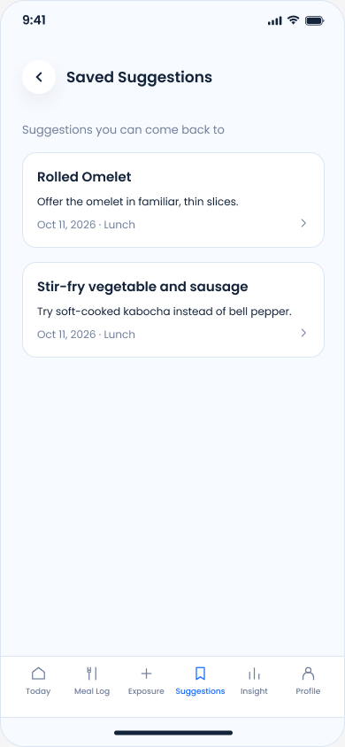

[S.09 Tried 목록](https://www.figma.com/design/mxsRk3PMmZGuNpJVeAiRi5?node-id=622-542)

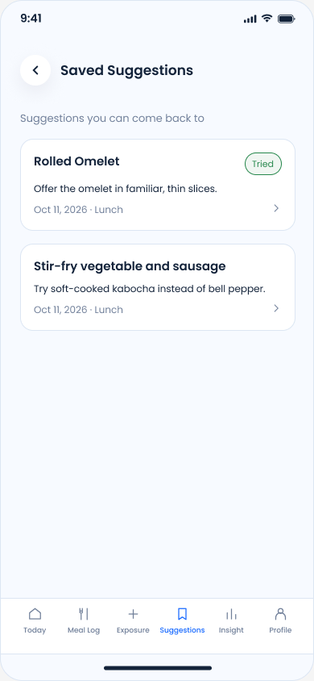

word description

### 상태

| 조건 | 상태 |
| --- | --- |
| 저장 0개 | 저장된 추천이 없다는 메시지를 보여준다. `View Meal History` 버튼을 보여준다. |
| 저장 1개 이상 | 저장 시각이 최신인 순서로 음식명과 추천 미리보기를 표시한다. 추천에 출처 날짜·식사 종류가 남아 있으면 해당 정보도 표시한다. 이미 시도한 추천에는 `Tried`를 표시한다. 추천 미리보기는 `What to Try` 를 한 문장으로 보여준다. 이를 넘으면 말줄임표로 처리한다. |
| 이전에 Suggestion을 `Remove`한 경우 | `Suggestion Removed from Saved` 를 보여준다. |

### 동작

| 조건 | 동작 |
| --- | --- |
| `View meal history` | `Meal History`로 이동한다.  |
| 다른 탭으로 이동·다시 진입 | 저장 상태를 다시 조회한다. 목록은 직전 스크롤을 복원한다.  |
| 목록 카드 클릭 | 해당 추천 상세 바텀시트를 연다. 바텀시트가 닫혀도 목록 스크롤을 유지한다. |

## 바텀시트

Figma

[S.03 미시도 상세](https://www.figma.com/design/mxsRk3PMmZGuNpJVeAiRi5?node-id=622-182)

[S.03b 시도 상세](https://www.figma.com/design/mxsRk3PMmZGuNpJVeAiRi5?node-id=653-2)

[S.11 제거 후 목록](https://www.figma.com/design/mxsRk3PMmZGuNpJVeAiRi5?node-id=622-662)

[S.01 마지막 항목 제거 후](https://www.figma.com/design/mxsRk3PMmZGuNpJVeAiRi5?node-id=622-62)

[S.04 방법 메뉴](https://www.figma.com/design/mxsRk3PMmZGuNpJVeAiRi5?node-id=622-242)

[S.04b 시도 후에도 같은 메뉴](https://www.figma.com/design/mxsRk3PMmZGuNpJVeAiRi5?node-id=656-5)

[기존 Meal Check-in 연결 설명](https://www.figma.com/design/mxsRk3PMmZGuNpJVeAiRi5?node-id=633-53)

image

[S.03 미시도 상세](https://www.figma.com/design/mxsRk3PMmZGuNpJVeAiRi5?node-id=622-182)

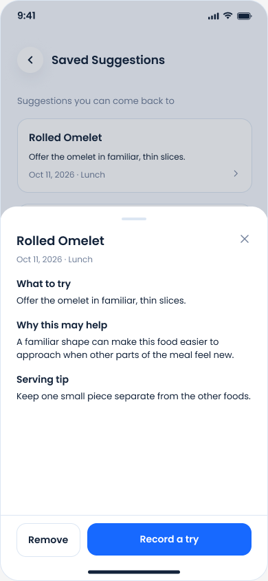

[S.03b 시도 상세](https://www.figma.com/design/mxsRk3PMmZGuNpJVeAiRi5?node-id=653-2)

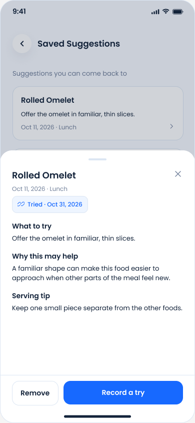

[S.11 제거 후 목록](https://www.figma.com/design/mxsRk3PMmZGuNpJVeAiRi5?node-id=622-662)

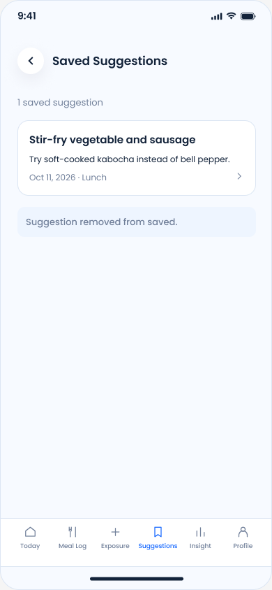

[S.01 마지막 항목 제거 후](https://www.figma.com/design/mxsRk3PMmZGuNpJVeAiRi5?node-id=622-62)

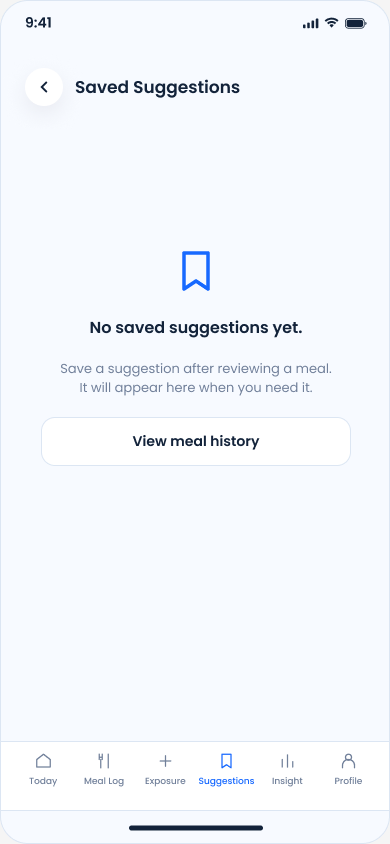

[S.04 방법 메뉴](https://www.figma.com/design/mxsRk3PMmZGuNpJVeAiRi5?node-id=622-242)

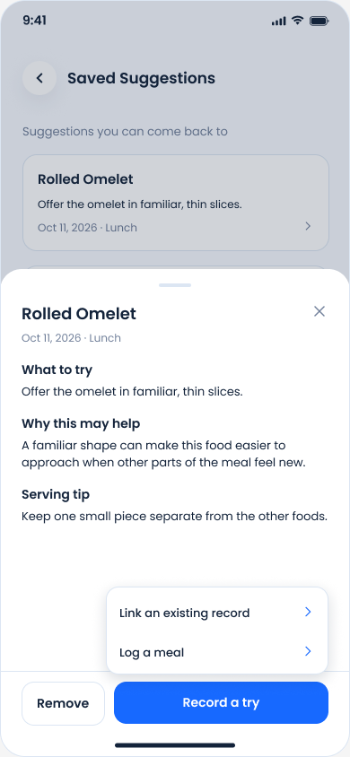

[S.04b 시도 후에도 같은 메뉴](https://www.figma.com/design/mxsRk3PMmZGuNpJVeAiRi5?node-id=656-5)

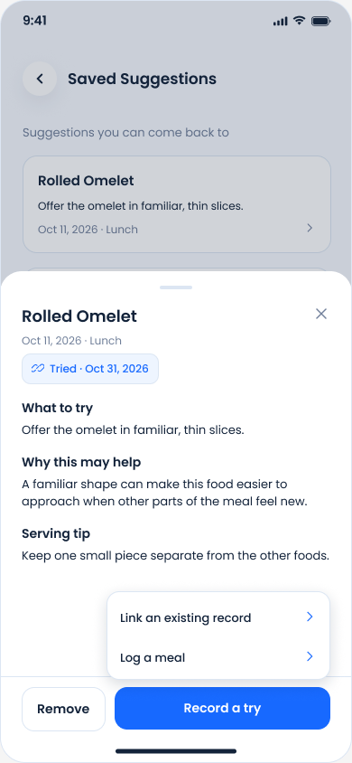

[기존 Meal Check-in 연결 설명](https://www.figma.com/design/mxsRk3PMmZGuNpJVeAiRi5?node-id=633-53)

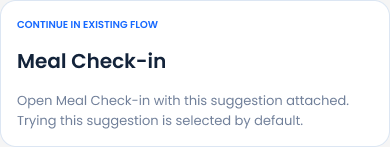

word description

### default

| 항목 | 기본 표시 |
| --- | --- |
| 추천 정보 | 음식명, `What to try`, `Why this may help`와 제공 팁을 표시한다. 출처 식사 정보가 있으면 날짜·종류를 함께 표시한다. 특정 식사가 없는 홈 추천도 열람·제거·시도 기록이 가능하다. |
| 버튼 | Remove, 닫기(X)와 시도 기록 버튼을 보여준다. 저장된 Trial이 0개면 Record a Try, 1개 이상이면 Add a Try로 표시한다. |
| 배치 | 제목·날짜·닫기와 하단 버튼은 고정한다. 추천 본문만 세로로 스크롤된다. |

### 상태

| 조건 | 상태 |
| --- | --- |
| Suggestion에 Trial이 1개 이상 있는 경우 | 시도 기록 버튼을 Add a Try로 표시한다. Trial마다 Tried / 시도한 식사 날짜 칩을 하나씩 보여준다. 같은 날짜의 서로 다른 Trial이 있는 경우에만 식사 때를 보여줘 구분한다. 칩이 많을 때 가로로 스크롤된다. |
| 기록 방법 선택 메뉴가 열린 경우 | `Link an existing record`, Log a meal을 보여준다. 이미 `Tried`한 경우에도 같은 메뉴를 보여준다. |
| 저장 목록에서 제거 중인 경우 | `Remove`, 시도 기록, 연결 식사 이동, 닫기와 드래그 닫기를 비활성화하고 중복 요청을 막는다. 성공 전까지 바텀시트와 목록 항목을 유지한다. |

### 동작

| 조건 | 동작 |
| --- | --- |
| `Remove` 클릭 | 저장 목록에서 제거하고 바텀시트를 닫는다. 목록을 갱신하고 제거됐다는 안내를 보여준다. 마지막 추천이면 저장된 추천이 없는 화면을 보여준다. 식사·시도·도움 여부 기록은 삭제하지 않는다. |
| Record a Try / Add a Try 클릭 | 기록 방법 선택 메뉴를 연다. Add a Try는 기존 Trial을 유지한 채 추가 시도를 기록한다. |
| `Link an existing record` 클릭 | `Link record (select meal)`로 이동한다. 같은 아이의 식사 기록 중 추천 생성 이후 저장된 기록을 조회한다. |
| Log a meal 클릭 | `Meal Check-in`으로 이동한다. `Trying this suggestion`은 선택된 상태이다. 미완료 체크인 초안이 있으면 기존 기록을 먼저 이어간다. 새 식사에 연결한 추천은 보호자가 실제 사용을 별도로 확인할 때까지 대기 상태로 둔다. 보호자가 새 식사의 사용 여부를 확인하는 화면의 위치는 미정이다. [Meal Check-in 명세](../meal-checkin/spec.md) · [노션 I3-OD-06](https://www.notion.so/420582b3bbeb801e9a66c2e42f7f4c6f#a9d582b3bbeb8292a6cb01d5fe86f98e) |
| 각 Tried / 시도 날짜 칩 클릭 | 선택한 Trial에 연결된 식사 ID로 Meal History의 Meal Review 화면을 연다. |
| 닫기(`X`), 배경 흐린 부분, 아래로 닫기, Android 뒤로가기 | 바텀시트를 닫는다. 저장 목록의 스크롤 위치는 유지한다. 기록 방법 메뉴가 열려 있으면 메뉴만 먼저 닫는다. |

저장 목록 제거는 추천 결정 취소(Undo)와 별개다. `DELETE /api/v1/suggestions/{id}/saved`는
저장 여부와 무관하게 소유한 추천에 대해 204를 반환하며, 반복 요청해도 같은 결과를 유지한다.
`SAVED`·`TRIED` 상태와 원래 저장 시각, 시도·도움 여부 기록은 보존하고 저장 목록 조회에서만 제외한다.
마지막 시도 기록을 삭제해도 제거한 추천이 저장 목록에 다시 나타나지 않는다.
보호자가 명시적으로 다시 저장하면 추천을 목록에 다시 포함한다.

### 에러

| 조건 | 내용 |
| --- | --- |
| 추천이 보관 해제됨 | `This suggestion is no longer saved.`를 보여주고 바텀시트를 열지 않는다. 이미 열려 있으면 닫고 목록을 갱신한다. |
| 제거 실패 | `Changes couldn't be saved. Please try again.`을 보여준다. 바텀시트와 목록 항목을 유지한다. |
| 추천의 출처 식사가 삭제됨 | 저장된 추천 내용과 출처 날짜는 유지하고 출처 식사로 이동만 막는다. Remove와 시도 기록 버튼(Trial 0개: Record a Try / 1개 이상: Add a Try)은 사용할 수 있다. |
| `Meal Review` 이동 시 연결된 식사에 접근할 수 없음 | `The linked meal is no longer available.`을 보여주고 바텀시트를 유지한다. |

## Link record (select meal)

Figma

[S.05 기록 목록](https://www.figma.com/design/mxsRk3PMmZGuNpJVeAiRi5?node-id=622-302)

[S.06 기록 선택](https://www.figma.com/design/mxsRk3PMmZGuNpJVeAiRi5?node-id=622-362)

image

[S.05 기록 목록](https://www.figma.com/design/mxsRk3PMmZGuNpJVeAiRi5?node-id=622-302)

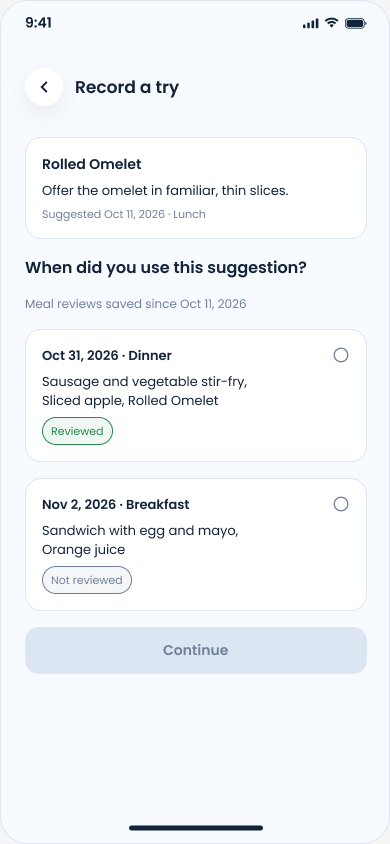

[S.06 기록 선택](https://www.figma.com/design/mxsRk3PMmZGuNpJVeAiRi5?node-id=622-362)

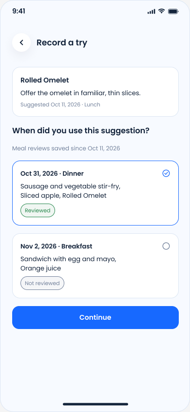

word description

### default

| 항목 | 기본 표시 |
| --- | --- |
| 추천 정보 | 음식명과 추천 미리보기를 표시한다. 출처 식사 날짜·종류는 해당 정보가 있을 때만 표시한다. |
| 식사 기록 목록 | `When did you use this suggestion?`과 식사 날짜·종류·음식명·`Reviewed` / `Not reviewed`를 보여준다. 기록 중 추천 생성 시각 이후에 최초 저장된 기록만 식사 날짜 내림차순으로 보여준다. |
| 버튼과 선택 | 뒤로가기와 `Continue`를 보여준다. 처음에는 선택된 식사가 없고 `Continue`는 비활성화한다. |

### 상태

| 조건 | 상태 |
| --- | --- |
| 식사 한 개 선택 | 선택한 식사를 표시하고 `Continue`를 활성화한다. 다른 식사를 고르면 이전 선택을 해제한다. |
| 식사 검토가 작성되지 않은 기록 | `Not reviewed`로 표시한다. 해당 기록도 선택할 수 있다. |
| 조건을 만족하는 식사가 없음 | 식사 기록 대신 `No eligible meal records yet`을 보여준다. |
| 기록 목록 조회 중 | 로딩 표시를 보여주고 `Continue`를 비활성화한다. 조회가 끝나기 전에는 기록이 없다는 안내를 보여주지 않는다. |

### 동작

| 조건 | 동작 |
| --- | --- |
| 식사 기록 클릭 | 해당 식사 하나를 선택한다.  |
| `Continue` 클릭 | 선택한 식사로 `Link record (confirm and link)`를 연다. |
| 뒤로가기 / Android 뒤로가기 | 추천 상세 바텀시트로 돌아간다. 시도 기록은 저장하지 않는다. |
| 조회 실패 후 `Retry` 클릭 | 식사 기록을 다시 조회한다.  |

### 에러

| 조건 | 내용 |
| --- | --- |
| 기록 조회 실패 | `Meal records couldn't be loaded. Please try again.`과 `Retry`를 보여준다. 최신 목록을 받기 전에는 `Continue`를 비활성화한다. |

## Link record (confirm and link)

Figma

[S.07 음식 확인](https://www.figma.com/design/mxsRk3PMmZGuNpJVeAiRi5?node-id=622-422)

image

](images/image-27.png)

word description

### default

| 항목 | 기본 표시 |
| --- | --- |
| 추천과 선택한 식사 | 추천 요약, `Confirm this try` 섹션에서 `Selected record`— 선택한 식사의 날짜,식사 때, 음식 및 추적 재료—를 보여준다. |
| 적용 대상 목록 | `Which food did you use it for?` 아래에 선택한 식사의 음식 및 추적 재료들을 보여준다. 흰색 카드 안에 왼쪽 라디오와 음식 이름만 있는 간단한 목록을 사용한다. 선택한 이름만 굵게 표시하며 Meal Check-in의 펼침 음식 카드·조리법·추가 설명·Edit을 재사용하지 않는다. |
| 버튼과 선택 | `Change`, `Confirm & Link Record`, 뒤로가기를 보여준다. 처음에는 선택된 음식이 없고 `Confirm & Link Record`는 비활성화한다. |

### 상태

| 조건 | 상태 |
| --- | --- |
| 음식 또는 추적 재료 한 개 선택 | 선택한 대상을 표시하고 `Confirm & Link Record`를 활성화한다. 다른 대상을 고르면 이전 선택을 해제한다. 음식과 재료를 동시에 선택할 수 없다. |
| 추적 재료가 없음 | 음식만 보여준다. 음식 선택과 시도 기록은 가능하다. |
| 시도 기록 저장 중 | `Confirm & Link Record`를 비활성화하고 중복 요청을 막는다. 성공 전까지 현재 선택을 유지한다. |

### 동작

| 조건 | 동작 |
| --- | --- |
| 음식 / 추적 재료 클릭 | 추천을 실제로 적용한 대상 하나를 선택한다. |
| Confirm & Link Record 클릭 | 추천과 선택한 식사·적용 대상을 연결해 시도를 저장한다. 성공하면 Try record feedback으로 이동한다.  |
| `Change` 클릭 / 뒤로가기 / Android 뒤로가기 | `Link record (select meal)`로 돌아가 기존 식사 선택을 유지한다. 이전 음식 선택 상태는 지운다. |
| 음식이 없는 경우 Edit meal 클릭 | 선택한 식사의 음식 편집으로 이동한다. 편집을 저장하고 돌아오면 목록을 갱신하고 사라진 선택을 해제한다. |

### 에러

| 조건 | 내용 |
| --- | --- |
| 선택한 식사나 음식이 삭제·변경되거나 접근 불가 | `The selected record has changed. Select it again.`을 보여준다. 목록을 갱신하고 선택을 해제한다.  |
| 시도 기록 저장 실패 | `Your try couldn't be recorded. Please try again.`을 보여준다. 선택을 유지하고 다시 시도할 수 있다. 성공 화면이나 `Tried`를 보여주지 않는다. |

## Try record feedback

Figma

[S.08 도움 여부](https://www.figma.com/design/mxsRk3PMmZGuNpJVeAiRi5?node-id=622-482)

[Not helpful 선택](https://www.figma.com/design/mxsRk3PMmZGuNpJVeAiRi5?node-id=632-2)

[Not sure 선택](https://www.figma.com/design/mxsRk3PMmZGuNpJVeAiRi5?node-id=632-41)

image

[S.08 도움 여부](https://www.figma.com/design/mxsRk3PMmZGuNpJVeAiRi5?node-id=622-482)

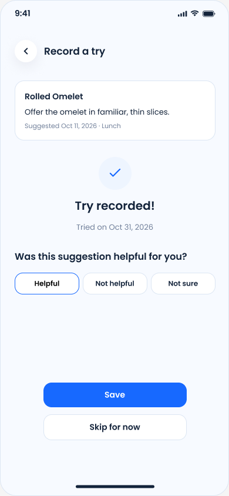

[Not helpful 선택](https://www.figma.com/design/mxsRk3PMmZGuNpJVeAiRi5?node-id=632-2)

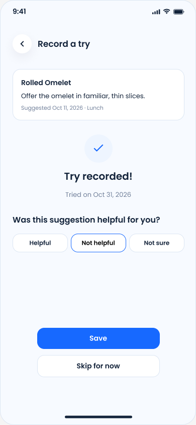

[Not sure 선택](https://www.figma.com/design/mxsRk3PMmZGuNpJVeAiRi5?node-id=632-41)

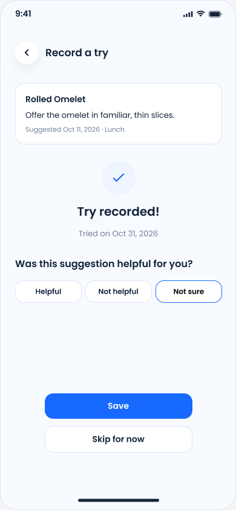

word description

### default

| 항목 | 기본 표시 |
| --- | --- |
| 시도 완료 정보 | 추천 요약, `Try recorded!`, `Tried on` 날짜를 보여준다. 이 화면에 진입할 때 시도 기록은 이미 저장된 상태다. |
| 피드백 | `Helpful`, `Not helpful`, `Not sure`를 보여준다. 처음에는 선택된 항목이 없다. |
| 버튼 | `Save`, `Skip for now`, 뒤로가기를 보여준다. `Save`는 비활성화한다. |

### 상태

| 조건 | 상태 |
| --- | --- |
| 피드백 한 개 선택 | 선택한 항목을 표시하고 `Save`를 활성화한다. 다른 항목을 누르면 선택을 바꾼다. |
| 피드백 저장 중 | `Save`를 비활성화한다.  |

### 동작

| 조건 | 동작 |
| --- | --- |
| `Helpful` / `Not helpful` / `Not sure` 클릭 | 피드백 하나를 선택한다. |
| `Save` 클릭 | 선택한 피드백를 해당 시도에 저장하고 `Saved Suggestions` 탭으로 이동한다. 해당 추천에 `Tried`를 보여준다. |
| `Skip for now` 클릭 | 선택했지만 저장하지 않은 피드백은 버리고 `Saved Suggestions` 탭으로 이동한다. 추천 시도 기록(trial)과 기존에 저장된 피드백은 유지한다. |
| 뒤로가기 / Android 뒤로가기 | 저장되지 않은 피드백은 버리고 `Saved Suggestions` 탭으로 이동한다. 추천 시도 기록(trial)은 유지한다. |

### 에러

| 조건 | 내용 |
| --- | --- |
| 피드백 저장 실패 | `Feedback couldn't be saved. Please try again.`을 보여준다. 선택과 이미 저장된 시도는 유지한다. `Save`로 다시 시도하거나 `Skip for now`로 나갈 수 있다. |

## 공통 규칙

- 앱을 다시 열면 저장·제외·시도 기록은 유지한다. 제외 이유의 임시 선택, 저장하지 않은 도움 여부, 되돌리기 이력은 복원하지 않는다. 계정이 바뀌면 이전 계정의 로컬 캐시를 정리한다.
- 화면 문구는 `util/strings.ts`에서 한국어·영어로 관리하고 색은 `util/colors.ts`를 사용한다. 작은 화면에서도 본문 스크롤과 카드의 모든 동작에 접근할 수 있어야 한다. [UI 컴포넌트 명세](../ui-components/spec.md)
- 화면 상태는 TypeScript 타입으로 정의하고 화면·데이터 조회·저장의 역할은 클라이언트 구조를 따른다. [클라이언트 아키텍처](../../docs/architecture.md)
