<!-- AI-generated with GPT-6, 2026-10-17, reviewed by Haechan Jung -->

# D — 추천 및 저장된 추천

## 기능 설명

보호자가 식사 검토를 저장한 뒤 음식별 추천을 확인하는 기능입니다. 추천 카드를 눌러 음식 정보를 보고, 추천을 저장하거나 제외하거나 나중으로 넘길 수 있습니다.

저장된 추천은 `Suggestions`에서 다시 확인한다. 실제로 시도한 식사와 음식을 연결하고 도움 여부를 남길 수 있으며, `Tried` 날짜를 누르면 연결한 식사 기록을 확인한다.

## 기능 범위

- 식사 검토 기능 이후 추천 및 음식 정보 확인

- 추천받을 음식 변경, 추천 저장·제외·건너뛰기, 직전 동작 되돌리기

- 저장된 추천 목록 확인, 개별 확인 및 저장 목록에서 제거

- 추천과 기존 식사 연결, 추천에 대해 새 식사 기록을 통한 시도 기록

- 도움 여부 저장 및 시도한 식사 기록 확인

# 추천 받기

- 추천 완료가 너무 커서, 추천 이전과 추천 완료로 분리

- 각 바텀시트는 별개의 화면으로 취급

## 추천 완료 이전

Figma

[D.01 생성 중](https://www.figma.com/design/mxsRk3PMmZGuNpJVeAiRi5?node-id=558-2)

[D.01b 생성 실패](https://www.figma.com/design/mxsRk3PMmZGuNpJVeAiRi5/%EC%86%8C%EA%B0%9C%EC%9B%90%EC%8B%A4?node-id=744-2&t=vDMMgCn7dkx64zTK-4)

image

[D.01 생성 중](https://www.figma.com/design/mxsRk3PMmZGuNpJVeAiRi5?node-id=558-2)

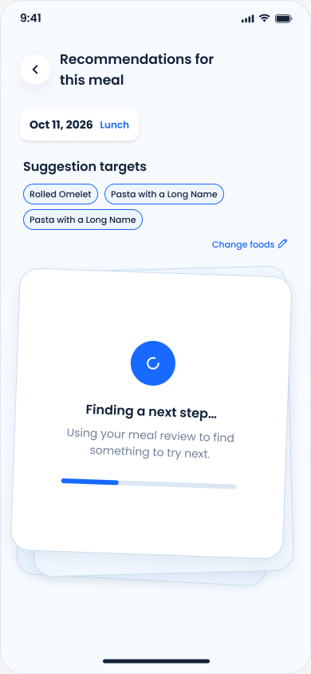

[D.01b 생성 실패](https://www.figma.com/design/mxsRk3PMmZGuNpJVeAiRi5/%EC%86%8C%EA%B0%9C%EC%9B%90%EC%8B%A4?node-id=744-2&t=vDMMgCn7dkx64zTK-4)

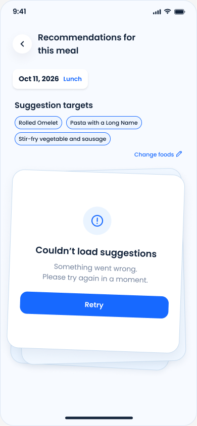

word description

### default

| 항목 | 기본 표시 |
| --- | --- |
| 식사와 대상 음식 | 식사 날짜 및 종류(Breakfast, Lunch, …), 추천 생성 대상 음식들과 `Change Foods` 버튼, 그리고 페이지 제목의 왼쪽에 ‘<’ 뒤로가기 버튼을 보여준다. |
| 로딩 | 추천을 생성 중이라는 안내 텍스트와 로딩 표시를 보여준다. |

### 상태

| 조건 | 상태 |
| --- | --- |
| 생성 실패 | 생성 실패 안내와 `Retry` 버튼을 보여준다. |

### 동작

| 조건 | 동작 |
| --- | --- |
| 첫 진입 | 진행 상황이 있다면 로딩 단계를 스킵하고 해당 화면으로 바로 이동한다. 일부 추천만 `Save`한 경우에는 다음 미처리 카드, 모든 추천을 Review한 경우에는 `All Suggestions Reviewed`로 이동한다. |
| 생성 완료 | 모든 대상의 유효 결과를 받은 후 한 번에 반영하고 추천 완료 화면으로 이동한다. |
| `Retry` 클릭 | 선택한 음식들에 대해 추천 생성을 다시 시도한다. |
| 뒤로가기 | 이전 화면으로 돌아간다. |
| `Change Foods` 클릭 | `Change Foods` 바텀시트를 연다. |

### 에러

| 조건 | 내용 |
| --- | --- |
| 네트워크 없음 / 생성 시작 후 60초까지 응답 없음 | 생성 실패로 처리한다. |
| 결과 0개·누락·잘못된 음식 ID·필수 본문 공백 | 생성 실패로 처리한다. |
| After Meal Review가 변경됨 | 추천을 다시 생성한다. |
| 원본 식사 삭제 / 접근 불가 | 진입 불가. 진입 시에는 `Home`으로 내보낸다. |

Change Foods 바텀시트

### default

| 항목 | 기본 표시 |
| --- | --- |
| 음식과 버튼 | 이 식사의 음식명·재료·체크박스와 `i of N selected`, `Cancel`, `Update suggestions`를 표시한다. |

### 상태

| 조건 | 상태 |
| --- | --- |
| 3개 선택 | 미선택 음식 체크박스는 비활성화하고 선택된 음식은 해제할 수 있다. |
| 0개 선택 또는 기존과 같은 선택 집합 | `Update suggestions`를 비활성화한다.  |
| 1~3개 선택 및 기존과 다른 집합 | `Update suggestions`를 활성화한다. |

### 동작

| 조건 | 동작 |
| --- | --- |
| `Cancel`, 배경 흐린 부분, `X` 클릭, Android 뒤로가기 | 임시 선택을 버리고 직전 카드·면·스크롤 위치로 돌아간다. 배경 탭·아래로 닫기·시스템 뒤로 가기도 동일하다. |
| `Update suggestions` | 시트를 닫고 서버에선 추가된 Food에 대해서만 새로 추천을 생성한다. 추천이 완료되면 추천 완료 섹션으로 넘어간다. 제거된 음식에 대한 추천이 `Saved`된 경우, `Saved Suggestion`에서는 삭제하지 않는다. 카드는 단순히 최종 Food Item들에 대해 보여준다. |

## 추천 완료

Figma

[D.02 카드 앞면](https://www.figma.com/design/mxsRk3PMmZGuNpJVeAiRi5?node-id=576-2)

[D.05 음식 정보](https://www.figma.com/design/mxsRk3PMmZGuNpJVeAiRi5?node-id=595-2)

[D.03 기존 선택](https://www.figma.com/design/mxsRk3PMmZGuNpJVeAiRi5?node-id=576-49)

[D.04 선택 변경](https://www.figma.com/design/mxsRk3PMmZGuNpJVeAiRi5?node-id=576-96)

[D.06 이유 묻기](https://www.figma.com/design/mxsRk3PMmZGuNpJVeAiRi5?node-id=604-2)

[D.06b 이유 선택](https://www.figma.com/design/mxsRk3PMmZGuNpJVeAiRi5?node-id=605-47)

[D.07 제외 완료](https://www.figma.com/design/mxsRk3PMmZGuNpJVeAiRi5?node-id=604-62)

[D.08 저장 완료](https://www.figma.com/design/mxsRk3PMmZGuNpJVeAiRi5?node-id=604-122)

[D.09 다음 카드](https://www.figma.com/design/mxsRk3PMmZGuNpJVeAiRi5?node-id=604-182)

[D.02a 왼쪽 스와이프](https://www.figma.com/design/mxsRk3PMmZGuNpJVeAiRi5?node-id=758-2)

[D.02b 오른쪽 스와이프](https://www.figma.com/design/mxsRk3PMmZGuNpJVeAiRi5?node-id=758-64)

image

[D.02 카드 앞면](https://www.figma.com/design/mxsRk3PMmZGuNpJVeAiRi5?node-id=576-2)

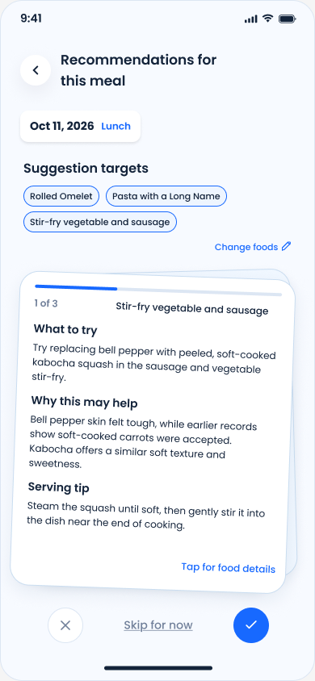

[D.05 음식 정보](https://www.figma.com/design/mxsRk3PMmZGuNpJVeAiRi5?node-id=595-2)

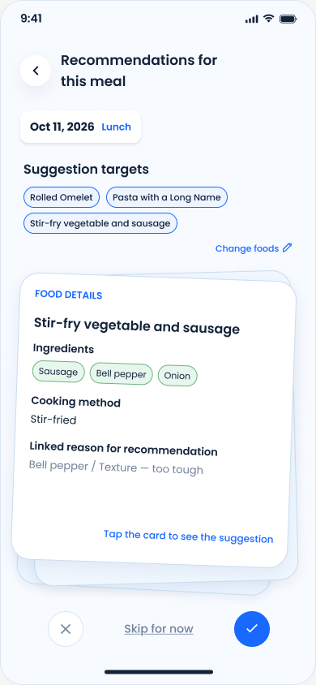

[D.03 기존 선택](https://www.figma.com/design/mxsRk3PMmZGuNpJVeAiRi5?node-id=576-49)

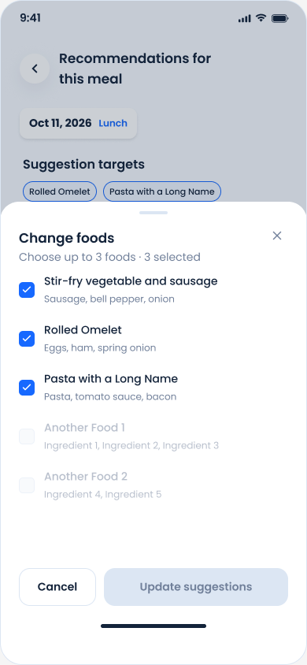

[D.04 선택 변경](https://www.figma.com/design/mxsRk3PMmZGuNpJVeAiRi5?node-id=576-96)

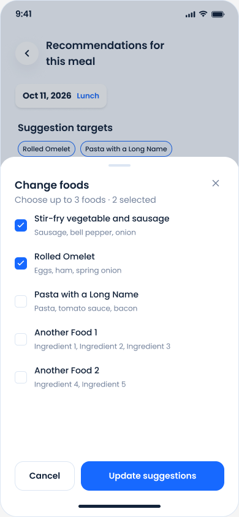

[D.06 이유 묻기](https://www.figma.com/design/mxsRk3PMmZGuNpJVeAiRi5?node-id=604-2)

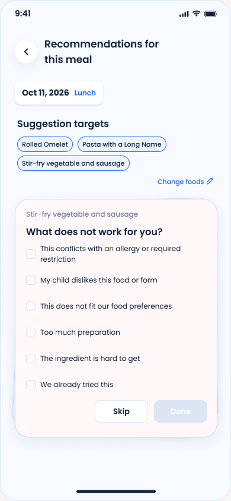

[D.06b 이유 선택](https://www.figma.com/design/mxsRk3PMmZGuNpJVeAiRi5?node-id=605-47)

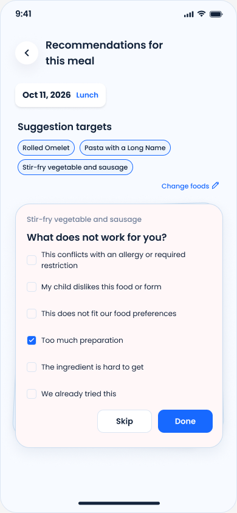

[D.07 제외 완료](https://www.figma.com/design/mxsRk3PMmZGuNpJVeAiRi5?node-id=604-62)

[D.08 저장 완료](https://www.figma.com/design/mxsRk3PMmZGuNpJVeAiRi5?node-id=604-122)

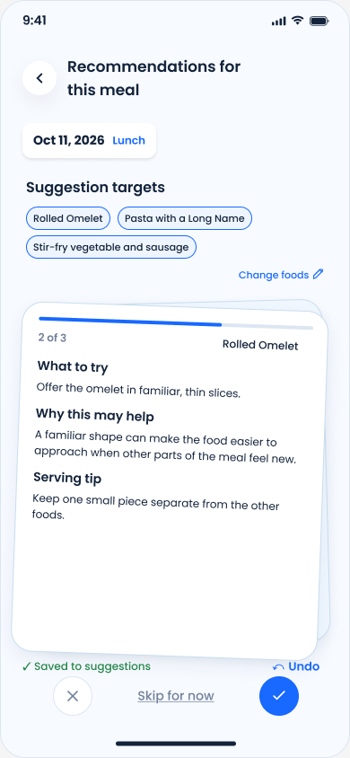

[D.09 다음 카드](https://www.figma.com/design/mxsRk3PMmZGuNpJVeAiRi5?node-id=604-182)

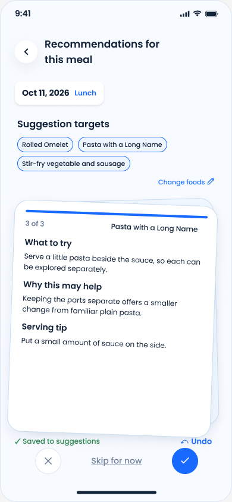

[D.02a 왼쪽 스와이프](https://www.figma.com/design/mxsRk3PMmZGuNpJVeAiRi5?node-id=758-2)

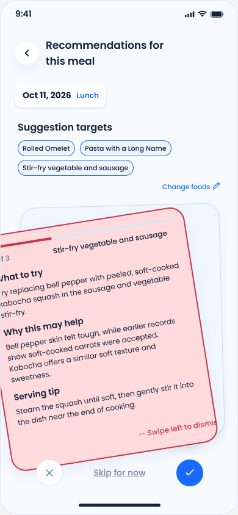

[D.02b 오른쪽 스와이프](https://www.figma.com/design/mxsRk3PMmZGuNpJVeAiRi5?node-id=758-64)

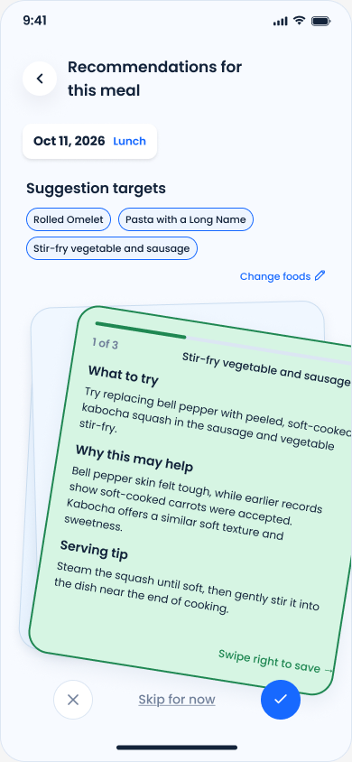

word description

### default

| 항목 | 기본 표시 |
| --- | --- |
| 카드 앞면 | 카드 내부에 몇 번째 카드인지(`i of N`), 대상 음식명, `What to try`, `Why this may help`, `Serving tip`, `Tap for food details`를 보여준다. |
| 카드 아래 버튼 | 추천 제외(`X`), `Skip for now`, 추천 저장(`O`)을 보여준다.  |
| 화면 상단 | 식사 날짜, 식사 종류, 대상 음식, `Change Foods`와 뒤로가기를 보여준다. |

### 상태

| 조건 | 상태 |
| --- | --- |
| 카드 뒷면 | `FOOD DETAILS`, `Ingredients`, `Cooking method`, `Linked reason for recommendation`과 추천 앞면으로 넘길 수 있다는 힌트를 보여준다. |
| 본문이 긴 경우 | 본문만 세로로 스크롤된다. |
| 왼쪽으로 스와이프 중 | 카드가 빨간색으로 물들고 계속 밀면 제외된다는 힌트를 보여준다. 완료 전에 놓으면 카드와 힌트가 원래대로 돌아온다. |
| 오른쪽으로 스와이프 중 | 카드가 초록색으로 물들고 계속 밀면 저장된다는 힌트를 보여준다. 완료 전에 놓으면 카드와 힌트가 원래대로 돌아온다. |

| 조건 | 상태 |
| --- | --- |
| 추천 제외 이유를 고르는 경우 | 카드 내부에 제외 이유 선택지와 `Skip`, `Done` 버튼을 보여준다. 복수 선택이 가능하며, 처음에는 `Done`을 비활성화한다. |
| 제외 이유를 하나 이상 선택한 경우 | 선택된 이유를 표시하고 `Done`을 활성화한다. 선택 항목을 다시 누르면 선택을 해제한다. 모두 해제하면 `Done`을 비활성화한다. |
| 추천 제외 완료 | 다음 카드와 `Suggestion dismissed`, `↶ Undo`를 보여준다. |
| 추천 저장 완료 | 다음 카드와 `✓ Saved to suggestions`, `↶ Undo`를 보여준다. |

### 동작

| 조건 | 동작 |
| --- | --- |
| 카드 탭 | 카드를 짧게 클릭하면 앞면과 뒷면이 바뀐다. 뒤집히는 애니메이션을 포함한다. |
| `Change Foods` 클릭 | `Change Foods` 바텀시트를 연다. |
| 추천 제외(`X`) 클릭 / 왼쪽 스와이프 완료 | 카드를 제외 이유 선택 카드로 바꾼다. 아직 제외 사유는 저장하지 않는다. |
| 제외 이유 선택지 클릭 | 해당 이유를 선택하거나 해제한다. 다른 선택지의 선택은 유지한다. |

| 조건 | 동작 |
| --- | --- |
| 이유 선택 후 `Done` 클릭 | 선택한 이유로 제외했음을 저장하고 다음 카드를 보여준다. |
| 제외 이유 선택에서 `Skip` 클릭 | 이유 없이 제외했음을 저장하고 다음 카드를 보여준다. |
| 추천 저장(`O`) 클릭 / 오른쪽 스와이프 완료 | 현재 추천을 저장하고 다음 카드를 보여준다. |
| `Skip for now` 클릭 | `Home`으로 이동한다. |

| 조건 | 동작 |
| --- | --- |
| `Undo` 클릭 | 직전 카드 처리 하나를 되돌리고 그 카드 앞면·스크롤 맨 위로 복귀한다. 제외를 되돌리면 이유를 지우고, 저장을 되돌리면 그 동작에서 새로 만든 저장만 취소한다. 기존 저장이나 별도로 추가된 시도 기록은 지우지 않는다. |
| `Undo` 연속 클릭 | 처리 이력을 역순으로 하나씩 되돌린다. A 저장 → B 제외 → `Undo`는 B 복원, 다시 `Undo`는 A 저장 취소다. 다른 화면으로 이동하거나 앱을 종료하면 `Undo` 이력은 사라지지만 카드 처리 상태는 유지한다. |

### 에러

| 조건 | 내용 |
| --- | --- |
| 저장 / 제외 / `Undo` 실패 | 동작 전 상태와 `Undo` 이력을 유지한다. |

Change Foods 바텀시트(위와 완전히 같은 내용)

### default

| 항목 | 기본 표시 |
| --- | --- |
| 음식과 버튼 | 이 식사의 음식명·재료·체크박스와 `i of N selected`, `Cancel`, `Update suggestions`를 표시한다. |

### 상태

| 조건 | 상태 |
| --- | --- |
| 3개 선택 | 미선택 음식 체크박스는 비활성화하고 선택된 음식은 해제할 수 있다. |
| 0개 선택 또는 기존과 같은 선택 집합 | `Update suggestions`를 비활성화한다.  |
| 1~3개 선택 및 기존과 다른 집합 | `Update suggestions`를 활성화한다. |

### 동작

| 조건 | 동작 |
| --- | --- |
| `Cancel`, 배경 흐린 부분, `X` 클릭, Android 뒤로가기 | 임시 선택을 버리고 직전 카드·면·스크롤 위치로 돌아간다. 배경 탭·아래로 닫기·시스템 뒤로 가기도 동일하다. |
| `Update suggestions` | 시트를 닫고 서버에선 추가된 Food에 대해서만 새로 추천을 생성한다. 추천이 완료되면 추천 완료 섹션으로 넘어간다. 제거된 음식에 대한 추천이 `Save`d된 경우, `Saved Suggestion`에서는 삭제하지 않는다. 카드는 단순히 최종 Food Item들에 대해 보여준다. |

## All Suggestions Reviewed

Figma

[D.10 모두 확인](https://www.figma.com/design/mxsRk3PMmZGuNpJVeAiRi5?node-id=622-2)

image

](images/image-14.png)

word description

### default

| 항목 | 기본 표시 |
| --- | --- |
| 완료 정보 | 추천 확인이 끝났다는 문구와 `Saved Suggestions`, `Back to Meal` 버튼을 보여준다. |

### 상태

| 조건 | 상태 |
| --- | --- |
| 되돌릴 이력이 있음 | `Undo` 버튼을 보여준다. |
| 되돌릴 이력이 없음 | `Undo` 버튼을 숨긴다. |

### 동작

| 조건 | 동작 |
| --- | --- |
| 마지막 카드 저장 / 제외, 추천 리뷰 건너뛰기로 진입 | `All Suggestions Reviewed`를 보여준다. |
| `Saved Suggestions` 클릭 | `Saved Suggestions` 탭으로 이동한다. |
| `Back to Meal` 클릭 | 원래 식사 검토 화면으로 돌아간다. 카드 처리 상태는 유지한다. |
| `Undo` 클릭 / 시스템 뒤로가기 | 추천 완료 페이지와 같은 흐름으로 마지막 카드의 저장·제외 또는 추천 건너뛰기를 취소한다. |

# Saved Suggestions

## 홈 - Saved Suggestions 탭

Figma

[S.01 빈 목록](https://www.figma.com/design/mxsRk3PMmZGuNpJVeAiRi5?node-id=622-62)

[S.02 저장 목록](https://www.figma.com/design/mxsRk3PMmZGuNpJVeAiRi5?node-id=622-122)

[S.09 Tried 목록](https://www.figma.com/design/mxsRk3PMmZGuNpJVeAiRi5?node-id=622-542)

image

[S.01 빈 목록](https://www.figma.com/design/mxsRk3PMmZGuNpJVeAiRi5?node-id=622-62)

[S.02 저장 목록](https://www.figma.com/design/mxsRk3PMmZGuNpJVeAiRi5?node-id=622-122)

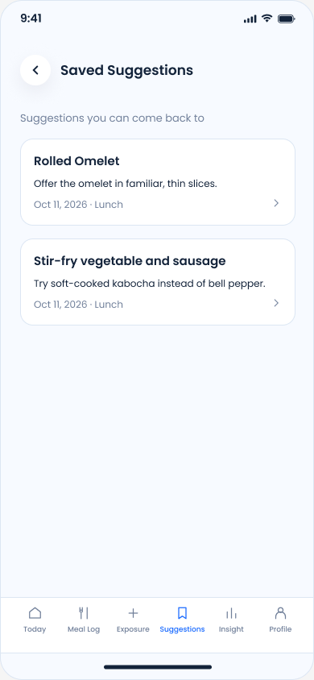

[S.09 Tried 목록](https://www.figma.com/design/mxsRk3PMmZGuNpJVeAiRi5?node-id=622-542)

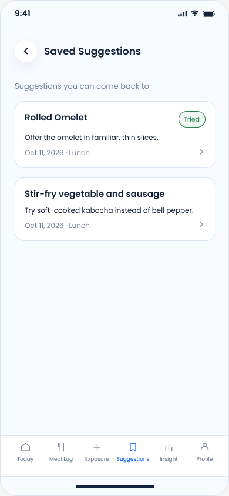

word description

### 상태

| 조건 | 상태 |
| --- | --- |
| 저장 0개 | 저장된 추천이 없다는 메시지를 보여준다. `View Meal History` 버튼을 보여준다. |
| 저장 1개 이상 | 음식명, 추천 미리보기, 식사 날짜와 종류를 카드 목록으로 저장 시각 내림차순으로 보여준다. 이미 시도한 추천에는 `Tried`를 표시한다. 추천 미리보기는 `What to Try` 를 한 문장으로 보여준다. 이를 넘으면 말줄임표로 처리한다. |
| 이전에 Suggestion을 `Remove`한 경우 | `Suggestion Removed from Saved` 를 보여준다. |

### 동작

| 조건 | 동작 |
| --- | --- |
| `View meal history` | `Meal History`로 이동한다.  |
| 다른 탭으로 이동·다시 진입 | 저장 상태를 다시 조회한다. 목록은 직전 스크롤을 복원한다.  |
| 목록 카드 클릭 | 해당 추천 상세 바텀시트를 연다. 바텀시트가 닫혀도 목록 스크롤을 유지한다. |

## 바텀시트

Figma

[S.03 미시도 상세](https://www.figma.com/design/mxsRk3PMmZGuNpJVeAiRi5?node-id=622-182)

[S.03b 시도 상세](https://www.figma.com/design/mxsRk3PMmZGuNpJVeAiRi5?node-id=653-2)

[S.11 제거 후 목록](https://www.figma.com/design/mxsRk3PMmZGuNpJVeAiRi5?node-id=622-662)

[S.01 마지막 항목 제거 후](https://www.figma.com/design/mxsRk3PMmZGuNpJVeAiRi5?node-id=622-62)

[S.04 방법 메뉴](https://www.figma.com/design/mxsRk3PMmZGuNpJVeAiRi5?node-id=622-242)

[S.04b 시도 후에도 같은 메뉴](https://www.figma.com/design/mxsRk3PMmZGuNpJVeAiRi5?node-id=656-5)

[기존 Meal Check-in 연결 설명](https://www.figma.com/design/mxsRk3PMmZGuNpJVeAiRi5?node-id=633-53)

image

[S.03 미시도 상세](https://www.figma.com/design/mxsRk3PMmZGuNpJVeAiRi5?node-id=622-182)

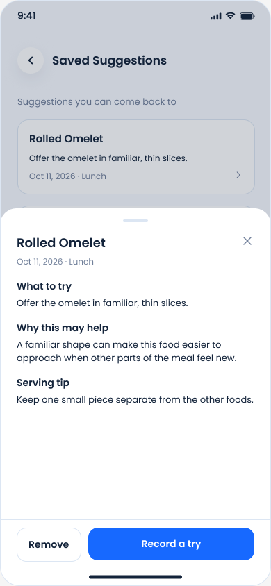

[S.03b 시도 상세](https://www.figma.com/design/mxsRk3PMmZGuNpJVeAiRi5?node-id=653-2)

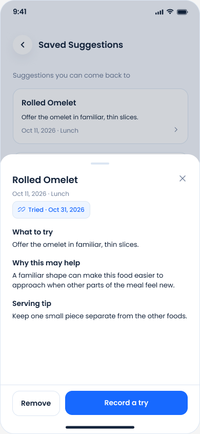

[S.11 제거 후 목록](https://www.figma.com/design/mxsRk3PMmZGuNpJVeAiRi5?node-id=622-662)

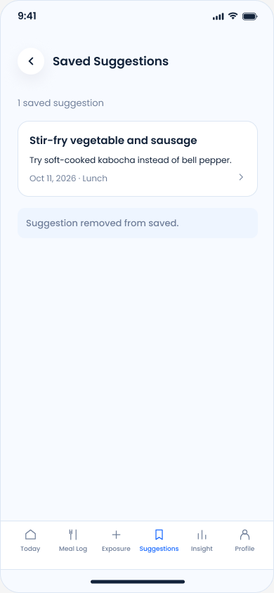

[S.01 마지막 항목 제거 후](https://www.figma.com/design/mxsRk3PMmZGuNpJVeAiRi5?node-id=622-62)

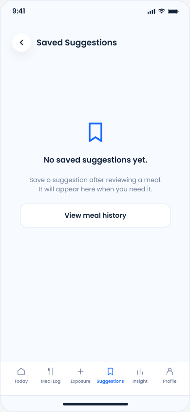

[S.04 방법 메뉴](https://www.figma.com/design/mxsRk3PMmZGuNpJVeAiRi5?node-id=622-242)

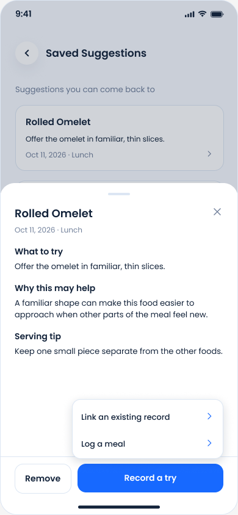

[S.04b 시도 후에도 같은 메뉴](https://www.figma.com/design/mxsRk3PMmZGuNpJVeAiRi5?node-id=656-5)

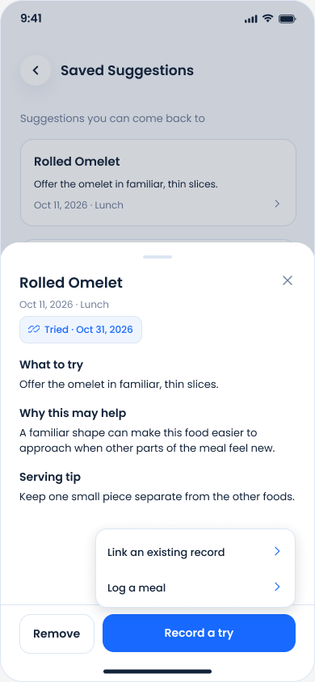

[기존 Meal Check-in 연결 설명](https://www.figma.com/design/mxsRk3PMmZGuNpJVeAiRi5?node-id=633-53)

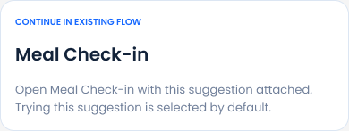

word description

### default

| 항목 | 기본 표시 |
| --- | --- |
| 추천 정보 | 음식명, 추천의 출처 날짜와 식사 때, `What to try`, `Why this may help`, `Serving tip`을 보여준다. |
| 버튼 | Remove, 닫기(X)와 시도 기록 버튼을 보여준다. 저장된 Trial이 0개면 Record a Try, 1개 이상이면 Add a Try로 표시한다. |
| 배치 | 제목·날짜·닫기와 하단 버튼은 고정한다. 추천 본문만 세로로 스크롤된다. |

### 상태

| 조건 | 상태 |
| --- | --- |
| Suggestion에 Trial이 1개 이상 있는 경우 | 시도 기록 버튼을 Add a Try로 표시한다. Trial마다 Tried / 시도한 식사 날짜 칩을 하나씩 보여준다. 같은 날짜의 서로 다른 Trial이 있는 경우에만 식사 때를 보여줘 구분한다. 칩이 많을 때 가로로 스크롤된다. |
| 기록 방법 선택 메뉴가 열린 경우 | `Link an existing record`, Log a meal을 보여준다. 이미 `Tried`한 경우에도 같은 메뉴를 보여준다. |
| 저장 목록에서 제거 중인 경우 | `Remove`를 비활성화하고 중복 요청을 막는다. 성공 전까지 바텀시트와 목록 항목을 유지한다. |

### 동작

| 조건 | 동작 |
| --- | --- |
| `Remove` 클릭 | 저장 목록에서 제거하고 바텀시트를 닫는다. 목록을 갱신하고 제거됐다는 안내를 보여준다. 마지막 추천이면 저장된 추천이 없는 화면을 보여준다. 식사·시도·도움 여부 기록은 삭제하지 않는다. |
| Record a Try / Add a Try 클릭 | 두 버튼 모두 기록 방법 선택 메뉴를 연다. Add a Try는 기존 Trial을 유지한 채 추가 시도를 기록하는 흐름이다. |
| `Link an existing record` 클릭 | `Link record (select meal)`로 이동한다. 같은 아이의 식사 기록 중 추천 생성 이후 저장된 기록을 조회한다. |
| Log a meal 클릭 | `Meal Check-in`으로 이동한다. `Trying this suggestion`은 선택된 상태이다. |
| 각 Tried / 시도 날짜 칩 클릭 | 선택한 Trial에 연결된 식사 ID로 Meal History의 Meal Review 화면을 연다. |
| 닫기(`X`), 배경 흐린 부분, 아래로 닫기, Android 뒤로가기 | 바텀시트를 닫는다. 저장 목록의 스크롤 위치는 유지한다. 기록 방법 메뉴가 열려 있으면 메뉴만 먼저 닫는다. |

### 에러

| 조건 | 내용 |
| --- | --- |
| 추천이 보관 해제됨 | `This suggestion is no longer saved.`를 보여주고 바텀시트를 열지 않는다. 이미 열려 있으면 닫고 목록을 갱신한다. |
| 제거 실패 | `Changes couldn't be saved. Please try again.`을 보여준다. 바텀시트와 목록 항목을 유지한다. |
| 추천의 출처 식사가 삭제됨 | 저장된 추천 내용과 출처 날짜는 유지하고 출처 식사로 이동만 막는다. Remove와 시도 기록 버튼(Trial 0개: Record a Try / 1개 이상: Add a Try)은 사용할 수 있다. |
| `Meal Review` 이동 시 연결된 식사에 접근할 수 없음 | `The linked meal is no longer available.`을 보여주고 바텀시트를 유지한다. |

## Link record (select meal)

Figma

[S.05 기록 목록](https://www.figma.com/design/mxsRk3PMmZGuNpJVeAiRi5?node-id=622-302)

[S.06 기록 선택](https://www.figma.com/design/mxsRk3PMmZGuNpJVeAiRi5?node-id=622-362)

image

[S.05 기록 목록](https://www.figma.com/design/mxsRk3PMmZGuNpJVeAiRi5?node-id=622-302)

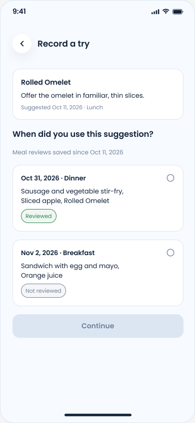

[S.06 기록 선택](https://www.figma.com/design/mxsRk3PMmZGuNpJVeAiRi5?node-id=622-362)

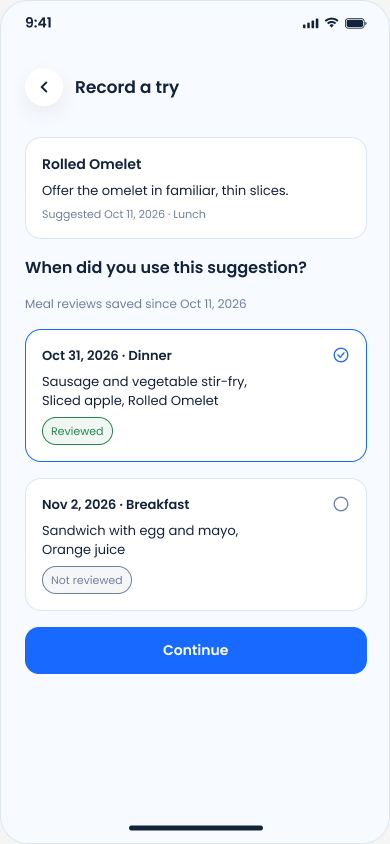

word description

### default

| 항목 | 기본 표시 |
| --- | --- |
| 추천 정보 | 음식명, 추천 미리보기, 추천의 출처 날짜와 식사 때를 보여준다. |
| 식사 기록 목록 | `When did you use this suggestion?`과 식사 날짜·종류·음식명·`Reviewed` / `Not reviewed`를 보여준다. 기록 중 추천 생성 시각 이후에 최초 저장된 기록만 식사 날짜 내림차순으로 보여준다. |
| 버튼과 선택 | 뒤로가기와 `Continue`를 보여준다. 처음에는 선택된 식사가 없고 `Continue`는 비활성화한다. |

### 상태

| 조건 | 상태 |
| --- | --- |
| 식사 한 개 선택 | 선택한 식사를 표시하고 `Continue`를 활성화한다. 다른 식사를 고르면 이전 선택을 해제한다. |
| 식사 검토가 작성되지 않은 기록 | `Not reviewed`로 표시한다. 해당 기록도 선택할 수 있다. |
| 조건을 만족하는 식사가 없음 | 식사 기록 대신 `No eligible meal records yet`을 보여준다. |
| 기록 목록 조회 중 | 로딩 표시를 보여주고 `Continue`를 비활성화한다. 조회가 끝나기 전에는 기록이 없다는 안내를 보여주지 않는다. |

### 동작

| 조건 | 동작 |
| --- | --- |
| 식사 기록 클릭 | 해당 식사 하나를 선택한다.  |
| `Continue` 클릭 | 선택한 식사로 `Link record (confirm and link)`를 연다. |
| 뒤로가기 / Android 뒤로가기 | 추천 상세 바텀시트로 돌아간다. 시도 기록은 저장하지 않는다. |
| 조회 실패 후 `Retry` 클릭 | 식사 기록을 다시 조회한다.  |

### 에러

| 조건 | 내용 |
| --- | --- |
| 기록 조회 실패 | `Meal records couldn't be loaded. Please try again.`과 `Retry`를 보여준다. 최신 목록을 받기 전에는 `Continue`를 비활성화한다. |

## Link record (confirm and link)

Figma

[S.07 음식 확인](https://www.figma.com/design/mxsRk3PMmZGuNpJVeAiRi5?node-id=622-422)

image

](images/image-27.png)

word description

### default

| 항목 | 기본 표시 |
| --- | --- |
| 추천과 선택한 식사 | 추천 요약, `Confirm this try` 섹션에서 `Selected record`— 선택한 식사의 날짜,식사 때, 음식 및 추적 재료—를 보여준다. |
| 적용 대상 목록 | `Which food did you use it for?` 아래에 선택한 식사의 음식 및 추적 재료들을 보여준다.  |
| 버튼과 선택 | `Change`, `Confirm & Link Record`, 뒤로가기를 보여준다. 처음에는 선택된 음식이 없고 `Confirm & Link Record`는 비활성화한다. |

### 상태

| 조건 | 상태 |
| --- | --- |
| 음식 또는 추적 재료 한 개 선택 | 선택한 대상을 표시하고 `Confirm & Link Record`를 활성화한다. 다른 대상을 고르면 이전 선택을 해제한다. 음식과 재료를 동시에 선택할 수 없다. |
| 추적 재료가 없음 | 음식만 보여준다. 음식 선택과 시도 기록은 가능하다. |
| 시도 기록 저장 중 | `Confirm & Link Record`를 비활성화하고 중복 요청을 막는다. 성공 전까지 현재 선택을 유지한다. |

### 동작

| 조건 | 동작 |
| --- | --- |
| 음식 / 추적 재료 클릭 | 추천을 실제로 적용한 대상 하나를 선택한다. |
| Confirm & Link Record 클릭 | 추천과 선택한 식사·적용 대상을 연결해 시도를 저장한다. 성공하면 Try record feedback으로 이동한다.  |
| `Change` 클릭 / 뒤로가기 / Android 뒤로가기 | `Link record (select meal)`로 돌아가 기존 식사 선택을 유지한다. 이전 음식 선택 상태는 지운다. |
| 음식이 없는 경우 Edit meal 클릭 | 선택한 식사의 음식 편집으로 이동한다. 편집을 저장하고 돌아오면 목록을 갱신하고 사라진 선택을 해제한다. |

### 에러

| 조건 | 내용 |
| --- | --- |
| 선택한 식사나 음식이 삭제·변경되거나 접근 불가 | `The selected record has changed. Select it again.`을 보여준다. 목록을 갱신하고 선택을 해제한다.  |
| 시도 기록 저장 실패 | `Your try couldn't be recorded. Please try again.`을 보여준다. 선택을 유지하고 다시 시도할 수 있다. 성공 화면이나 `Tried`를 보여주지 않는다. |

## Try record feedback

Figma

[S.08 도움 여부](https://www.figma.com/design/mxsRk3PMmZGuNpJVeAiRi5?node-id=622-482)

[Not helpful 선택](https://www.figma.com/design/mxsRk3PMmZGuNpJVeAiRi5?node-id=632-2)

[Not sure 선택](https://www.figma.com/design/mxsRk3PMmZGuNpJVeAiRi5?node-id=632-41)

image

[S.08 도움 여부](https://www.figma.com/design/mxsRk3PMmZGuNpJVeAiRi5?node-id=622-482)

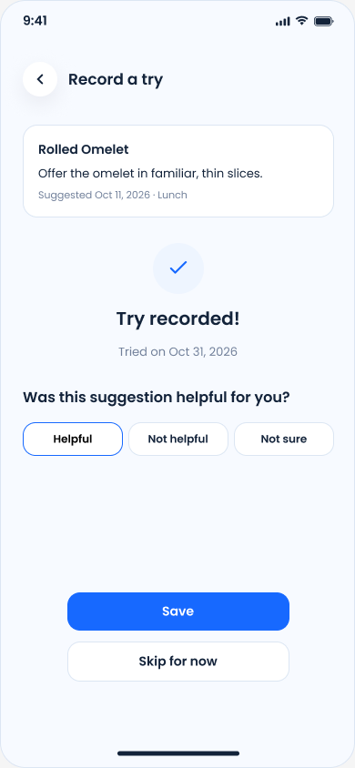

[Not helpful 선택](https://www.figma.com/design/mxsRk3PMmZGuNpJVeAiRi5?node-id=632-2)

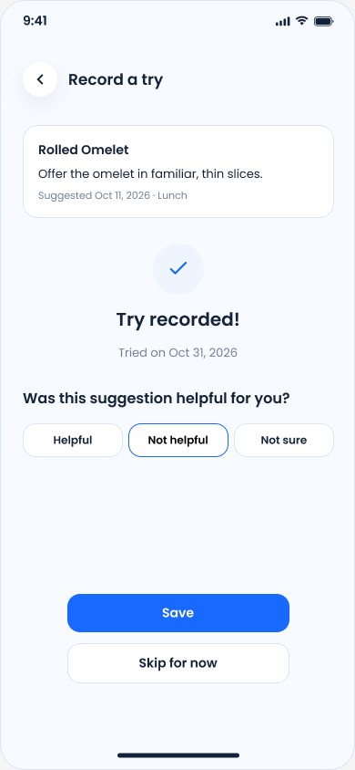

[Not sure 선택](https://www.figma.com/design/mxsRk3PMmZGuNpJVeAiRi5?node-id=632-41)

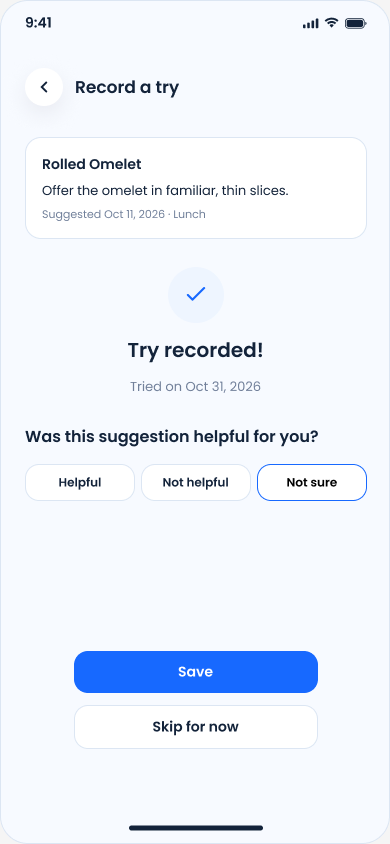

word description

### default

| 항목 | 기본 표시 |
| --- | --- |
| 시도 완료 정보 | 추천 요약, `Try recorded!`, `Tried on` 날짜를 보여준다. 이 화면에 진입할 때 시도 기록은 이미 저장된 상태다. |
| 피드백 | `Helpful`, `Not helpful`, `Not sure`를 보여준다. 처음에는 선택된 항목이 없다. |
| 버튼 | `Save`, `Skip for now`, 뒤로가기를 보여준다. `Save`는 비활성화한다. |

### 상태

| 조건 | 상태 |
| --- | --- |
| 피드백 한 개 선택 | 선택한 항목을 표시하고 `Save`를 활성화한다. 다른 항목을 누르면 선택을 바꾼다. |
| 피드백 저장 중 | `Save`를 비활성화한다.  |

### 동작

| 조건 | 동작 |
| --- | --- |
| `Helpful` / `Not helpful` / `Not sure` 클릭 | 피드백 하나를 선택한다. |
| `Save` 클릭 | 선택한 피드백를 해당 시도에 저장하고 `Saved Suggestions` 탭으로 이동한다. 해당 추천에 `Tried`를 보여준다. |
| `Skip for now` 클릭 | 선택했지만 저장하지 않은 피드백은 버리고 `Saved Suggestions` 탭으로 이동한다. 추천 시도 기록(trial)과 기존에 저장된 피드백은 유지한다. |
| 뒤로가기 / Android 뒤로가기 | 저장되지 않은 피드백은 버리고 `Saved Suggestions` 탭으로 이동한다. 추천 시도 기록(trial)은 유지한다. |

### 에러

| 조건 | 내용 |
| --- | --- |
| 피드백 저장 실패 | `Feedback couldn't be saved. Please try again.`을 보여준다. 선택과 이미 저장된 시도는 유지한다. `Save`로 다시 시도하거나 `Skip for now`로 나갈 수 있다. |

## 공통 규칙

word description

### 시간과 복원

| 조건 | 규칙 |
| --- | --- |
| 앱을 다시 실행한 경우 | 확정된 음식 선택과 카드 처리 상태를 복원한다. 카드 앞면부터 보여 주며, 시트의 임시 선택·미저장 피드백·`Undo` 이력은 복원하지 않는다. |
| 로그아웃한 경우 | 로컬에 저장되는 캐시는 계정이 바뀌면 정리한다. |
| API가 응답이 없는 경우 | 같은 요청의 결과를 먼저 확인하고 재시도한다. |

