<!-- AI-generated with GPT-6, 2026-10-17, reviewed by Haechan Jung -->
<!-- Changed: 추천 카드·저장된 추천 기능 추가 -->
<!-- AI-generated with GPT-6, 2026-10-18, reviewed by Haechan Jung -->
<!-- Changed: 화면 디자인 및 식사 흐름 개선 -->

<!-- AI-generated with GPT-6, 2026-11-02, reviewed by Seoyeon Heo -->
<!-- Changed: 음식 추천 대상 자동 선택 및 기존 카드가 있어도 대상 변경 지원 -->

<!-- AI-generated with GPT-6, 2026-11-13, reviewed by Haechan Jung -->
<!-- Changed: 거절 후 추가 추천 선택·대상 재사용 및 Skip 제거 명세 -->

# D — 추천 및 저장된 추천

## 기능 설명

보호자가 확인한 아동 프로필과 식사·식후 기록을 바탕으로 다음 식사에서 시도할 작은 변화 하나를 제안한다. 보호자는 추천 카드에서 음식 정보·시도할 일·이유·제공 팁을 확인하고, 추천을 저장하거나 제외한다.

저장된 추천은 `Suggestions`에서 다시 확인한다. 실제로 시도한 식사와 음식을 연결하고 도움 여부를 남길 수 있으며, `Tried` 날짜를 누르면 연결한 식사 기록을 확인한다.

추천 입력·안전성·근거·생성 제한은 [추천 정책](../../../server/docs/recommendation-policy.md)을 따른다.
카드·버튼의 공통 시각 규칙은 [UI 컴포넌트 명세](../ui-components/spec.md)를 따른다.
추천 진입점은 [식후 검토 명세](../after-meal-review/spec.md)와 [Home 명세](../home/spec.md)를 따른다.

## 추천 대상

- 추천 대상은 식후 검토가 저장된 음식 중 결과가 Eaten이 아닌 음식이다. 별도 추적 재료는 추천 대상 목록과 추천 카드 생성에서 제외한다.
- 이미 생성된 Eaten 음식의 추천은 해당 식사의 추천 화면에서 숨기며 새로 생성하지 않는다. 모든 음식이 Eaten이면 식후 검토 완료 화면에서 추천 버튼을 숨기고, 추천 화면에 직접 진입하면 식사 상세로 돌아간다.
- 추천 대상 음식이 1~3개이면 화면 진입 시 전부 자동 선택하고 아직 추천이 없는 음식의 카드를 생성한다. 기존 카드·저장·제외 상태는 유지한다.
- 추천 대상 음식이 4개 이상이면 사용자가 최대 3개를 선택해 생성한다. 음식이 없거나 식후 검토가 없으면 자동 생성하지 않는다.
- 대상이 이미 선택되었거나 추천 카드가 생성되어도 Choose targets로 바텀시트를 연다. 전체 음식 목록과 현재 선택값을 표시하고, 변경을 확정하면 선택한 음식의 기존 카드를 재사용하며 미처리 추가 추천을 먼저 표시한다. 대상 변경만으로 추가 추천을 생성하지 않는다. 새로 선택한 음식에 추천이 없을 때만 최초 추천을 생성한다. 취소하면 현재 선택을 유지한다.
- 음식과 기존 추천 조회가 완료된 뒤에 생성한다. 자동 생성은 진입당 한 번 시도하며 실패하면 선택한 대상을 유지하고 Retry로 누락된 카드만 다시 요청한다.

## 첫 추천 거절 후 추가 추천

보호자는 음식별 첫 추천을 거절한 뒤 원하는 경우 추가 추천을 한 번 받는다.
거절은 보호자가 추천 카드를 제외하는 동작이며, 식후 결과의 `Not eaten`과 구분한다.

### 횟수와 대상

- 해당 식사에 기록된 음식 하나의 추천을 처음 거절하면 `새 추천 받기 / Regenerate` 버튼을 제공한다. 버튼을 눌러야 새 추천을 생성한다.
- 음식의 기준은 이름이 아닌 `origin_food_id`다. 다른 식사의 같은 이름 음식은 별도 대상이다. 식후 결과가 Eaten인 음식은 기존 규칙대로 제외한다.
- 최초 추천 외 추가 추천은 음식별로 최대 한 번 성공할 수 있다. 새 추천도 거절하면 다시 생성하는 버튼은 제공하지 않는다.
- 생성 실패는 성공 횟수에 포함하지 않는다. 화면 재진입·앱 재시작·대상 선택 변경·식후 검토 수정·Undo로 성공 횟수를 초기화하지 않는다.
- 횟수와 최초 거절 대상은 서버가 관리한다. 기기 메모리나 현재 `dismissed` 카드 개수만으로 판단하지 않는다.

### 화면과 동작

| 조건 | 동작 |
| --- | --- |
| 첫 추천의 제외 이유 선택 후 `Done` 저장 성공 | 추가 생성 요청 없이 해당 음식의 거절 확인 단계를 표시한다. 음식명·선택한 이유와 새 추천을 받을지 묻는 문구를 카드 본문에, `Regenerate`와 `Continue` 버튼을 카드 하단에 나란히 표시한다. `Undo`는 카드 밖 기존 하단 상태 영역의 버튼을 사용한다. 선택 전에는 다음 카드나 완료 화면으로 넘어가지 않는다. |
| `Continue` 클릭 | 추가 생성 없이 다음 미처리 카드로 이동한다. 복원된 다른 거절 확인 단계가 있으면 그 선택을 먼저 보여주며, 남은 카드·선택이 없으면 완료 화면으로 이동한다. 추가 생성 기회는 소진하지 않는다. |
| 마지막 카드가 첫 거절 대상임 | 완료 화면보다 먼저 같은 거절 확인 단계를 표시한다. 완료 화면에는 추가 생성 버튼을 모아 두지 않는다. |
| 추가 생성 가능한 음식이 여러 개임 | 한 번에 해당 음식 하나의 거절 확인 단계를 표시한다. 그 음식의 선택을 마친 뒤 다음 음식으로 이동한다. |
| 재진입 또는 대상 재선택 | 이미 생성된 미처리 추가 추천을 먼저 보여준다. 그 외에는 선택된 음식 중 추가 생성 가능한 첫 거절의 확인 단계를 복원한다. 같은 화면 방문에서 추가 생성 없이 계속한 음식은 다시 묻지 않으며, 재진입·대상 재선택 시에는 다시 선택할 수 있다. 자동 생성하지 않는다. |
| `Regenerate` 클릭 | 해당 음식의 기존 추천과 제외 이유를 포함해 새 추천을 요청한다. 생성 중에는 최초 추천 생성과 같은 회전 아이콘·안내 문구의 로딩 카드를 표시하고 중복 생성·카드 처리·Undo·대상 변경을 막는다. 화면 이탈은 허용한다. |
| 생성 성공 | 새 ID의 미처리 추천 카드를 먼저 보여준다. 기존 거절 기록과 다른 음식의 카드·저장·시도 기록을 유지한다. |
| 생성 실패 | 같은 거절 확인 단계에 머물며 선택한 이유와 `Retry`, 추가 생성 없이 계속하기를 제공한다. 다른 음식의 진행 상태는 유지한다. |
| 응답 유실 또는 생성 중 이탈 후 재진입 | 서버에서 이미 저장된 결과를 먼저 확인하고 있으면 재사용한다. 늦게 도착한 응답이 다른 식사·아이의 화면을 바꾸지 않는다. |
| 첫 거절을 Undo | 원래 카드를 복원하고 제외 이유를 지운다. 추가 생성 전이면 버튼을 숨기고 같은 카드를 다시 거절할 때 복원한다. 이미 생성된 추가 추천과 사용 횟수는 지우지 않는다. |
| 추가 추천의 저장·거절을 Undo | 해당 카드 처리만 되돌린다. 추가 생성 기회는 복구하지 않는다. |

### 완료 조건

- A의 거절 이유를 확정하면 생성 요청 없이 B 카드나 완료 화면보다 먼저 A의 추가 생성 선택을 보여준다. `Regenerate`를 눌러야 A의 새 카드를 요청하며, `Continue`를 누르면 생성 없이 B로 이동한다.
- 커피의 추가 추천을 만든 뒤 커피·케이크에서 커피만 선택하면 같은 미처리 추가 추천을 표시한다. 케이크로 바꿨다가 커피로 돌아와도 생성 요청 없이 같은 카드 ID와 처리 상태를 유지한다.
- 추가 카드를 다시 거절하거나 앱을 재시작해도 세 번째 추천을 만들 수 없다. 첫 거절을 Undo 후 다시 거절해도 추가 생성 성공은 최대 한 번이다.
- 마지막 카드의 거절 이유를 확정해도 먼저 추가 생성 여부를 선택한다. 추가 생성 없이 계속하기를 누르면 기존 완료 화면으로 이동한다.
- 요청 실패는 재시도 가능하고, 연속 탭·동시 기기 요청·성공 응답 유실 후 재시도에도 추가 추천은 중복 저장되지 않는다.
- 타인의 추천, 다른 음식의 추천, 거절하지 않은 추천, Eaten 음식에 대한 추가 생성은 서버가 거부한다.
- 새 추천은 기존 거절 내용과 사유를 참고하고 현재 제한 검증을 통과한다. 검증 실패 결과는 표시하거나 저장하지 않는다.

생성 입력·재시도·저장 원칙은 [추천 정책 R6](../../../server/docs/recommendation-policy.md#r6--첫-거절-후-선택적-추가-생성)를 따른다.

## 기능 범위

- 식사 검토 기능 이후 추천 및 음식 정보 확인

- 추천받을 음식 변경, 추천 저장·제외, 직전 동작 되돌리기

- 음식별 첫 추천 거절 후 선택적 추가 추천 한 번 받기

- 저장된 추천 목록 확인, 개별 확인 및 저장 목록에서 제거

- 추천과 기존 식사 연결, 추천에 대해 새 식사 기록을 통한 시도 기록

- 도움 여부 저장 및 시도한 식사 기록 확인

# 추천 받기

- 추천 완료가 너무 커서, 추천 이전과 추천 완료로 분리

- 각 바텀시트는 별개의 화면으로 취급

## 추천 완료 이전

Figma

[D.01 생성 중](https://www.figma.com/design/mxsRk3PMmZGuNpJVeAiRi5?node-id=558-2)

[D.01b 생성 실패](https://www.figma.com/design/mxsRk3PMmZGuNpJVeAiRi5/%EC%86%8C%EA%B0%9C%EC%9B%90%EC%8B%A4?node-id=744-2&t=vDMMgCn7dkx64zTK-4)

image

[D.01 생성 중](https://www.figma.com/design/mxsRk3PMmZGuNpJVeAiRi5?node-id=558-2)

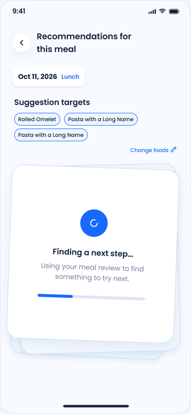

[D.01b 생성 실패](https://www.figma.com/design/mxsRk3PMmZGuNpJVeAiRi5/%EC%86%8C%EA%B0%9C%EC%9B%90%EC%8B%A4?node-id=744-2&t=vDMMgCn7dkx64zTK-4)

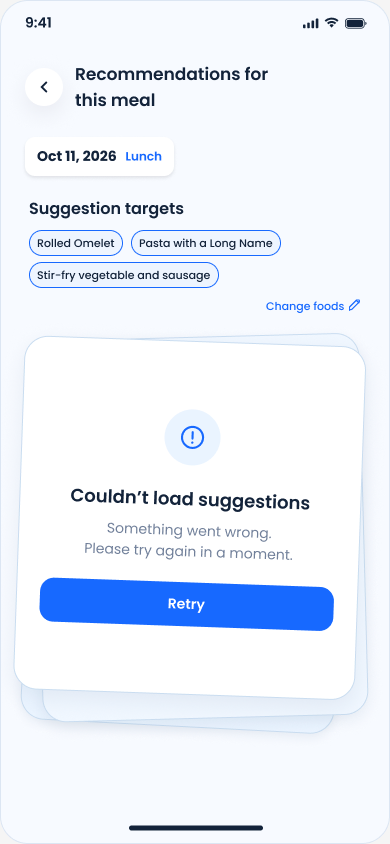

word description

### default

| 항목 | 기본 표시 |
| --- | --- |
| 식사와 대상 음식 | 식사 날짜 및 종류(Breakfast, Lunch, …), 추천 생성 대상 음식들과 `Change Foods` 버튼, 그리고 페이지 제목의 왼쪽에 ‘<’ 뒤로가기 버튼을 보여준다. |
| 로딩 | 추천을 생성 중이라는 안내 텍스트와 로딩 표시를 보여준다. |

### 상태

| 조건 | 상태 |
| --- | --- |
| 생성 실패 | 생성 실패 안내와 `Retry` 버튼을 보여준다. |

### 동작

| 조건 | 동작 |
| --- | --- |
| 첫 진입 | 진행 상황이 있다면 로딩 단계를 스킵하고 해당 화면으로 바로 이동한다. 미처리 추가 추천과 첫 거절 확인 단계의 복원은 [첫 추천 거절 후 추가 추천](#첫-추천-거절-후-추가-추천)을 따른다. 남은 선택이나 카드가 없으면 `All Suggestions Reviewed`로 이동한다. |
| 생성 완료 | 모든 대상의 유효 결과를 받은 후 한 번에 반영하고 추천 완료 화면으로 이동한다. |
| `Retry` 클릭 | 선택한 음식들에 대해 추천 생성을 다시 시도한다. |
| 뒤로가기 | 이전 화면으로 돌아간다. |
| `Change Foods` 클릭 | `Change Foods` 바텀시트를 연다. |

### 에러

| 조건 | 내용 |
| --- | --- |
| 네트워크 없음 / 생성 시작 후 60초까지 응답 없음 | 생성 실패로 처리한다. |
| 결과 0개·누락·잘못된 음식 ID·필수 본문 공백 | 생성 실패로 처리한다. |
| After Meal Review가 변경됨 | 최신 추천 대상을 조회하고 Eaten 음식의 카드를 숨긴다. 기존 카드와 추가 생성 이력을 유지하며, 추천이 없는 대상의 최초 생성만 허용한다. |
| 원본 식사 삭제 / 접근 불가 | 진입 불가. 진입 시에는 `Home`으로 내보낸다. |

Change Foods 바텀시트

### default

| 항목 | 기본 표시 |
| --- | --- |
| 음식과 버튼 | 이 식사의 음식명·재료·체크박스와 `i of N selected`, `Cancel`, `Update suggestions`를 표시한다. |

### 상태

| 조건 | 상태 |
| --- | --- |
| 3개 선택 | 미선택 음식 체크박스는 비활성화하고 선택된 음식은 해제할 수 있다. |
| 0개 선택 또는 기존과 같은 선택 집합 | `Update suggestions`를 비활성화한다.  |
| 1~3개 선택 및 기존과 다른 집합 | `Update suggestions`를 활성화한다. |

### 동작

| 조건 | 동작 |
| --- | --- |
| `Cancel`, 배경 흐린 부분, `X` 클릭, Android 뒤로가기 | 임시 선택을 버리고 직전 카드·면·스크롤 위치로 돌아간다. 배경 탭·아래로 닫기·시스템 뒤로 가기도 동일하다. |
| `Update suggestions` | 시트를 닫고 선택된 음식의 기존 카드를 재사용하며 미처리 추가 추천을 먼저 보여준다. 추천이 없는 음식의 최초 추천만 생성한다. 대상 변경만으로 추가 추천을 생성하지 않고, 선택에서 빠진 음식의 저장 기록도 유지한다. |

## 추천 완료

Figma

[D.02 카드 앞면](https://www.figma.com/design/mxsRk3PMmZGuNpJVeAiRi5?node-id=576-2)

[D.05 음식 정보](https://www.figma.com/design/mxsRk3PMmZGuNpJVeAiRi5?node-id=595-2)

[D.03 기존 선택](https://www.figma.com/design/mxsRk3PMmZGuNpJVeAiRi5?node-id=576-49)

[D.04 선택 변경](https://www.figma.com/design/mxsRk3PMmZGuNpJVeAiRi5?node-id=576-96)

[D.06 이유 묻기](https://www.figma.com/design/mxsRk3PMmZGuNpJVeAiRi5?node-id=604-2)

[D.06b 이유 선택](https://www.figma.com/design/mxsRk3PMmZGuNpJVeAiRi5?node-id=605-47)

[D.07 제외 완료](https://www.figma.com/design/mxsRk3PMmZGuNpJVeAiRi5?node-id=604-62)

[D.08 저장 완료](https://www.figma.com/design/mxsRk3PMmZGuNpJVeAiRi5?node-id=604-122)

[D.09 다음 카드](https://www.figma.com/design/mxsRk3PMmZGuNpJVeAiRi5?node-id=604-182)

[D.02a 왼쪽 스와이프](https://www.figma.com/design/mxsRk3PMmZGuNpJVeAiRi5?node-id=758-2)

[D.02b 오른쪽 스와이프](https://www.figma.com/design/mxsRk3PMmZGuNpJVeAiRi5?node-id=758-64)

image

[D.02 카드 앞면](https://www.figma.com/design/mxsRk3PMmZGuNpJVeAiRi5?node-id=576-2)

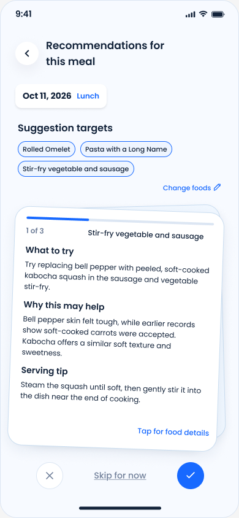

[D.05 음식 정보](https://www.figma.com/design/mxsRk3PMmZGuNpJVeAiRi5?node-id=595-2)

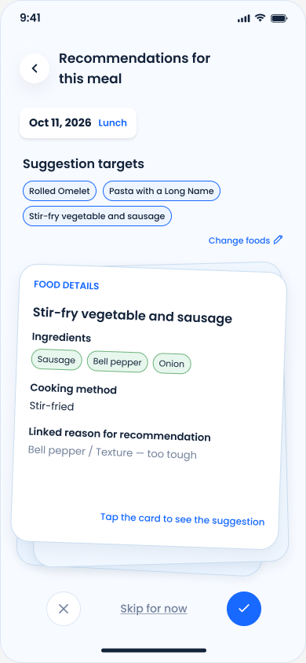

[D.03 기존 선택](https://www.figma.com/design/mxsRk3PMmZGuNpJVeAiRi5?node-id=576-49)

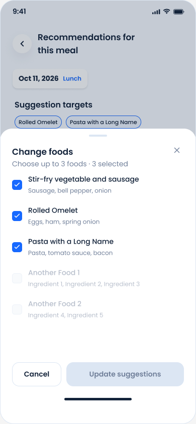

[D.04 선택 변경](https://www.figma.com/design/mxsRk3PMmZGuNpJVeAiRi5?node-id=576-96)

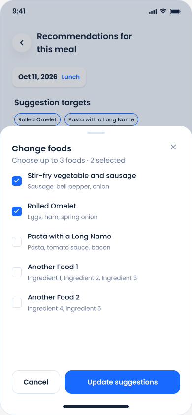

[D.06 이유 묻기](https://www.figma.com/design/mxsRk3PMmZGuNpJVeAiRi5?node-id=604-2)

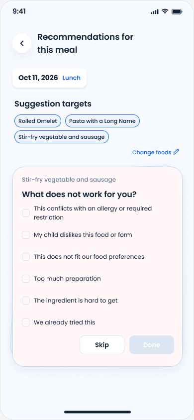

[D.06b 이유 선택](https://www.figma.com/design/mxsRk3PMmZGuNpJVeAiRi5?node-id=605-47)

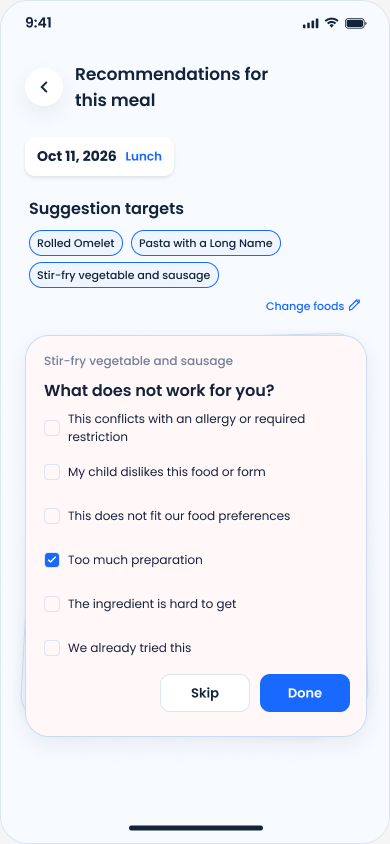

[D.07 제외 완료](https://www.figma.com/design/mxsRk3PMmZGuNpJVeAiRi5?node-id=604-62)

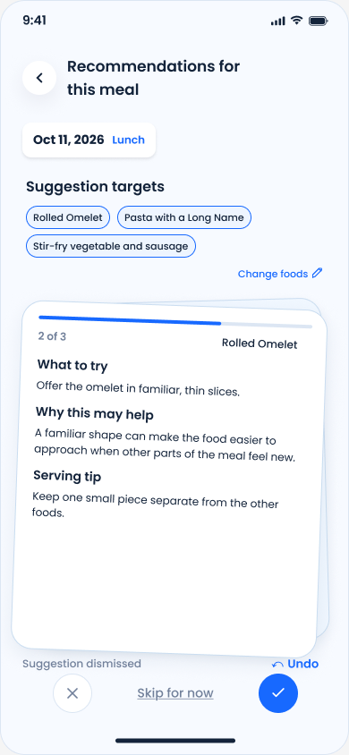

[D.08 저장 완료](https://www.figma.com/design/mxsRk3PMmZGuNpJVeAiRi5?node-id=604-122)

[D.09 다음 카드](https://www.figma.com/design/mxsRk3PMmZGuNpJVeAiRi5?node-id=604-182)

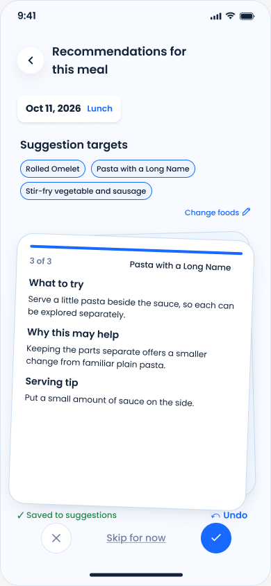

[D.02a 왼쪽 스와이프](https://www.figma.com/design/mxsRk3PMmZGuNpJVeAiRi5?node-id=758-2)

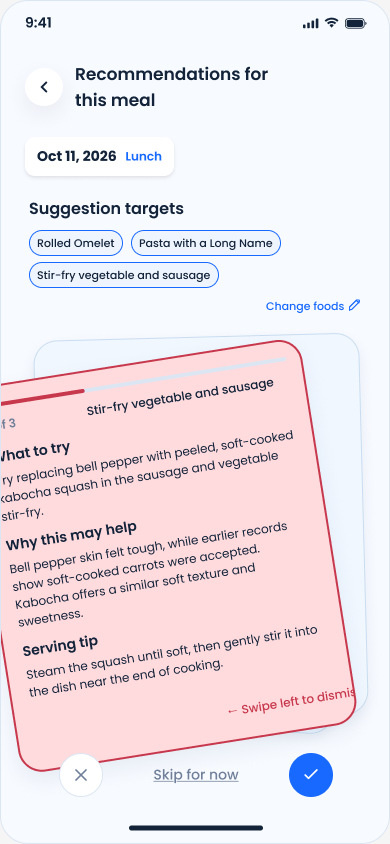

[D.02b 오른쪽 스와이프](https://www.figma.com/design/mxsRk3PMmZGuNpJVeAiRi5?node-id=758-64)

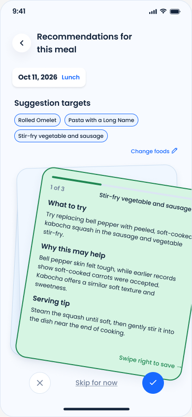

word description

### default

| 항목 | 기본 표시 |
| --- | --- |
| 카드 앞면 | 카드 내부에 몇 번째 카드인지(`i of N`), 대상 음식명, `What to try`, `Why this may help`, `Serving tip`, `Tap for food details`를 보여준다. |
| 카드 아래 버튼 | 추천 제외(`X`)와 추천 저장(`O`)을 보여준다. 화면을 나가려면 상단 뒤로가기를 사용한다. |
| 화면 상단 | 식사 날짜, 식사 종류, 대상 음식, `Change Foods`와 뒤로가기를 보여준다. |

### 상태

| 조건 | 상태 |
| --- | --- |
| 카드 뒷면 | `FOOD DETAILS`, `Ingredients`, `Cooking method`, `Linked reason for recommendation`과 추천 앞면으로 넘길 수 있다는 힌트를 보여준다. |
| 본문이 긴 경우 | 본문만 세로로 스크롤된다. |
| 왼쪽으로 스와이프 중 | 카드가 빨간색으로 물들고 계속 밀면 제외된다는 힌트를 보여준다. 완료 전에 놓으면 카드와 힌트가 원래대로 돌아온다. |
| 오른쪽으로 스와이프 중 | 카드가 초록색으로 물들고 계속 밀면 저장된다는 힌트를 보여준다. 완료 전에 놓으면 카드와 힌트가 원래대로 돌아온다. |

| 조건 | 상태 |
| --- | --- |
| 추천 제외 이유를 고르는 경우 | 카드 내부에 제외 이유 선택지와 `Cancel`, `Done` 버튼을 보여준다. 복수 선택이 가능하며, 처음에는 `Done`을 비활성화한다. |
| 제외 이유를 하나 이상 선택한 경우 | 선택된 이유를 표시하고 `Done`을 활성화한다. 선택 항목을 다시 누르면 선택을 해제한다. 모두 해제하면 `Done`을 비활성화한다. |
| 추천 제외 완료 | 추가 생성 가능한 첫 거절은 [거절 확인 단계](#첫-추천-거절-후-추가-추천)를 보여준다. 그 외에는 다음 카드 또는 완료 화면으로 이동한다. `Undo`로 직전 처리를 되돌릴 수 있다. |
| 추천 저장 완료 | 다음 카드와 `✓ Saved to suggestions`, `↶ Undo`를 보여준다. |

### 동작

| 조건 | 동작 |
| --- | --- |
| 카드 탭 | 카드를 짧게 클릭하면 앞면과 뒷면이 바뀐다. 뒤집히는 애니메이션을 포함한다. |
| `Change Foods` 클릭 | `Change Foods` 바텀시트를 연다. |
| 추천 제외(`X`) 클릭 / 왼쪽 스와이프 완료 | 카드를 제외 이유 선택 카드로 바꾼다. 아직 제외 사유는 저장하지 않는다. |
| 제외 이유 선택지 클릭 | 해당 이유를 선택하거나 해제한다. 다른 선택지의 선택은 유지한다. |

| 조건 | 동작 |
| --- | --- |
| 이유 선택 후 `Done` 클릭 | 선택한 이유로 제외했음을 저장한다. 추가 생성 가능한 첫 거절이면 즉시 거절 확인 단계를 보여주고, 그 외에는 다음 카드 또는 완료 화면으로 이동한다. |
| 제외 이유 선택에서 `Cancel` 클릭 | 거절을 저장하지 않고 원래 추천 카드로 돌아간다. |
| 추천 저장(`O`) 클릭 / 오른쪽 스와이프 완료 | 현재 추천을 저장하고 다음 카드를 보여준다. |

| 조건 | 동작 |
| --- | --- |
| `Undo` 클릭 | 직전 카드 처리 하나를 되돌리고 그 카드 앞면·스크롤 맨 위로 복귀한다. 제외를 되돌리면 이유를 지우고, 저장을 되돌리면 그 동작에서 새로 만든 저장만 취소한다. 기존 저장이나 별도로 추가된 시도 기록은 지우지 않는다. |
| `Undo` 연속 클릭 | 처리 이력을 역순으로 하나씩 되돌린다. A 저장 → B 제외 → `Undo`는 B 복원, 다시 `Undo`는 A 저장 취소다. 다른 화면으로 이동하거나 앱을 종료하면 `Undo` 이력은 사라지지만 카드 처리 상태는 유지한다. |

### 에러

| 조건 | 내용 |
| --- | --- |
| 저장 / 제외 / `Undo` 실패 | 동작 전 상태와 `Undo` 이력을 유지한다. |

Change Foods 바텀시트(위와 완전히 같은 내용)

### default

| 항목 | 기본 표시 |
| --- | --- |
| 음식과 버튼 | 이 식사의 음식명·재료·체크박스와 `i of N selected`, `Cancel`, `Update suggestions`를 표시한다. |

### 상태

| 조건 | 상태 |
| --- | --- |
| 3개 선택 | 미선택 음식 체크박스는 비활성화하고 선택된 음식은 해제할 수 있다. |
| 0개 선택 또는 기존과 같은 선택 집합 | `Update suggestions`를 비활성화한다.  |
| 1~3개 선택 및 기존과 다른 집합 | `Update suggestions`를 활성화한다. |

### 동작

| 조건 | 동작 |
| --- | --- |
| `Cancel`, 배경 흐린 부분, `X` 클릭, Android 뒤로가기 | 임시 선택을 버리고 직전 카드·면·스크롤 위치로 돌아간다. 배경 탭·아래로 닫기·시스템 뒤로 가기도 동일하다. |
| `Update suggestions` | 시트를 닫고 선택된 음식의 기존 카드를 재사용하며 미처리 추가 추천을 먼저 보여준다. 추천이 없는 음식의 최초 추천만 생성한다. 대상 변경만으로 추가 추천을 생성하지 않고, 선택에서 빠진 음식의 저장 기록도 유지한다. |

## All Suggestions Reviewed

Figma

[D.10 모두 확인](https://www.figma.com/design/mxsRk3PMmZGuNpJVeAiRi5?node-id=622-2)

image

](images/image-14.png)

word description

### default

| 항목 | 기본 표시 |
| --- | --- |
| 완료 정보 | 추천 확인이 끝났다는 문구와 `Saved Suggestions`, `Back to Meal` 버튼을 보여준다. |

### 상태

| 조건 | 상태 |
| --- | --- |
| 첫 거절 후 추가 생성 선택이 남아 있음 | 완료 화면 대신 [거절 확인 단계](#첫-추천-거절-후-추가-추천)를 보여준다. |
| 되돌릴 이력이 있음 | `Undo` 버튼을 보여준다. |
| 되돌릴 이력이 없음 | `Undo` 버튼을 숨긴다. |

### 동작

| 조건 | 동작 |
| --- | --- |
| 마지막 카드 처리와 필요한 추가 생성 선택을 마침 | `All Suggestions Reviewed`를 보여준다. |
| `Saved Suggestions` 클릭 | `Saved Suggestions` 탭으로 이동한다. |
| `Back to Meal` 클릭 | 원래 식사 검토 화면으로 돌아간다. 카드 처리 상태는 유지한다. |
| `Undo` 클릭 / 시스템 뒤로가기 | 추천 완료 페이지와 같은 흐름으로 마지막 카드의 저장·제외를 취소한다. |

# Saved Suggestions

## 홈 - Saved Suggestions 탭

Figma

[S.01 빈 목록](https://www.figma.com/design/mxsRk3PMmZGuNpJVeAiRi5?node-id=622-62)

[S.02 저장 목록](https://www.figma.com/design/mxsRk3PMmZGuNpJVeAiRi5?node-id=622-122)

[S.09 Tried 목록](https://www.figma.com/design/mxsRk3PMmZGuNpJVeAiRi5?node-id=622-542)

image

[S.01 빈 목록](https://www.figma.com/design/mxsRk3PMmZGuNpJVeAiRi5?node-id=622-62)

[S.02 저장 목록](https://www.figma.com/design/mxsRk3PMmZGuNpJVeAiRi5?node-id=622-122)

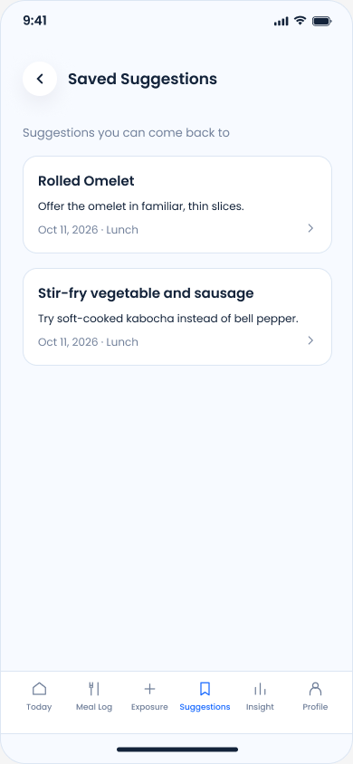

[S.09 Tried 목록](https://www.figma.com/design/mxsRk3PMmZGuNpJVeAiRi5?node-id=622-542)

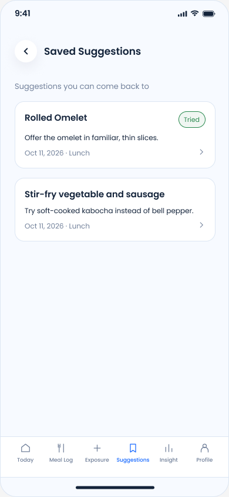

word description

### 상태

| 조건 | 상태 |
| --- | --- |
| 저장 0개 | 저장된 추천이 없다는 메시지를 보여준다. `View Meal History` 버튼을 보여준다. |
| 저장 1개 이상 | 음식명, 추천 미리보기, 식사 날짜와 종류를 카드 목록으로 저장 시각 내림차순으로 보여준다. 이미 시도한 추천에는 `Tried`를 표시한다. 추천 미리보기는 `What to Try` 를 한 문장으로 보여준다. 이를 넘으면 말줄임표로 처리한다. |
| 이전에 Suggestion을 `Remove`한 경우 | `Suggestion Removed from Saved` 를 보여준다. |

### 동작

| 조건 | 동작 |
| --- | --- |
| `View meal history` | `Meal History`로 이동한다.  |
| 다른 탭으로 이동·다시 진입 | 저장 상태를 다시 조회한다. 목록은 직전 스크롤을 복원한다.  |
| 목록 카드 클릭 | 해당 추천 상세 바텀시트를 연다. 바텀시트가 닫혀도 목록 스크롤을 유지한다. |

## 바텀시트

Figma

[S.03 미시도 상세](https://www.figma.com/design/mxsRk3PMmZGuNpJVeAiRi5?node-id=622-182)

[S.03b 시도 상세](https://www.figma.com/design/mxsRk3PMmZGuNpJVeAiRi5?node-id=653-2)

[S.11 제거 후 목록](https://www.figma.com/design/mxsRk3PMmZGuNpJVeAiRi5?node-id=622-662)

[S.01 마지막 항목 제거 후](https://www.figma.com/design/mxsRk3PMmZGuNpJVeAiRi5?node-id=622-62)

[S.04 방법 메뉴](https://www.figma.com/design/mxsRk3PMmZGuNpJVeAiRi5?node-id=622-242)

[S.04b 시도 후에도 같은 메뉴](https://www.figma.com/design/mxsRk3PMmZGuNpJVeAiRi5?node-id=656-5)

[기존 Meal Check-in 연결 설명](https://www.figma.com/design/mxsRk3PMmZGuNpJVeAiRi5?node-id=633-53)

image

[S.03 미시도 상세](https://www.figma.com/design/mxsRk3PMmZGuNpJVeAiRi5?node-id=622-182)

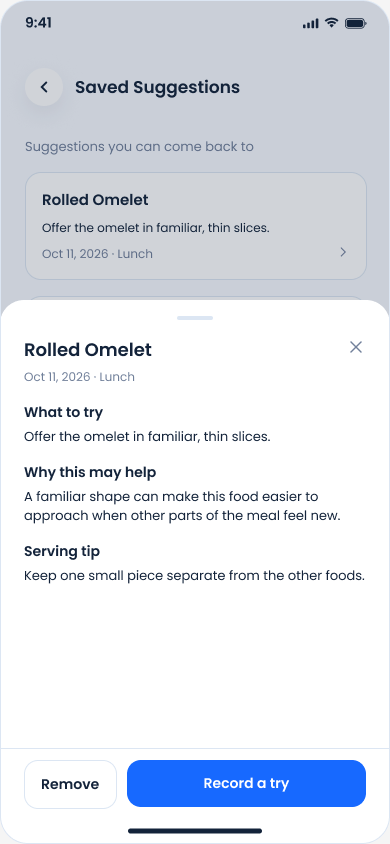

[S.03b 시도 상세](https://www.figma.com/design/mxsRk3PMmZGuNpJVeAiRi5?node-id=653-2)

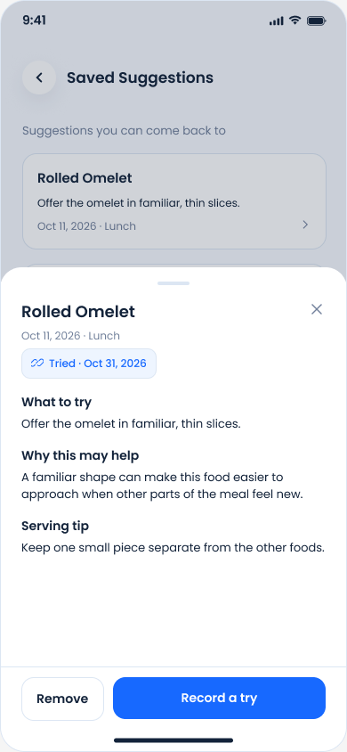

[S.11 제거 후 목록](https://www.figma.com/design/mxsRk3PMmZGuNpJVeAiRi5?node-id=622-662)

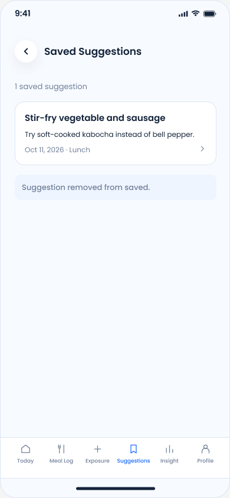

[S.01 마지막 항목 제거 후](https://www.figma.com/design/mxsRk3PMmZGuNpJVeAiRi5?node-id=622-62)

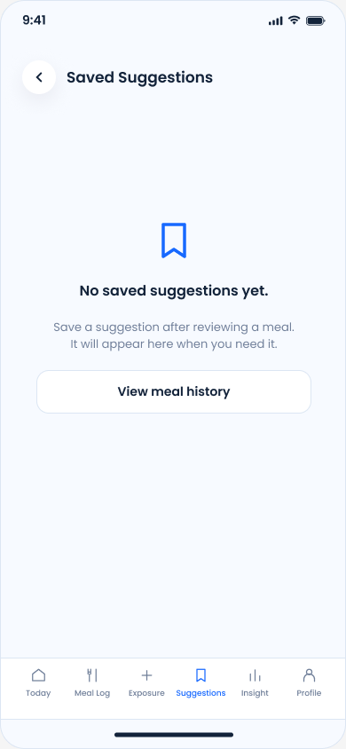

[S.04 방법 메뉴](https://www.figma.com/design/mxsRk3PMmZGuNpJVeAiRi5?node-id=622-242)

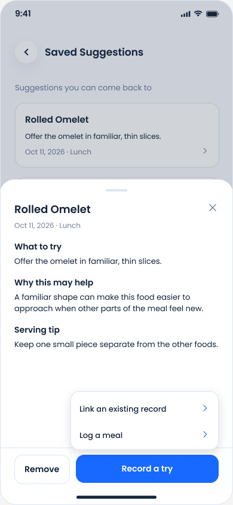

[S.04b 시도 후에도 같은 메뉴](https://www.figma.com/design/mxsRk3PMmZGuNpJVeAiRi5?node-id=656-5)

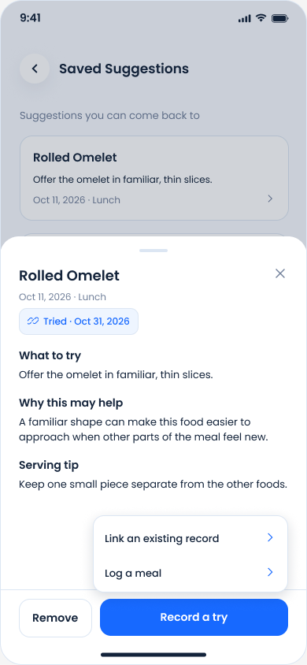

[기존 Meal Check-in 연결 설명](https://www.figma.com/design/mxsRk3PMmZGuNpJVeAiRi5?node-id=633-53)

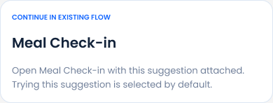

word description

### default

| 항목 | 기본 표시 |
| --- | --- |
| 추천 정보 | 음식명, 추천의 출처 날짜와 식사 때, `What to try`, `Why this may help`, `Serving tip`을 보여준다. |
| 버튼 | Remove, 닫기(X)와 시도 기록 버튼을 보여준다. 저장된 Trial이 0개면 Record a Try, 1개 이상이면 Add a Try로 표시한다. |
| 배치 | 제목·날짜·닫기와 하단 버튼은 고정한다. 추천 본문만 세로로 스크롤된다. |

### 상태

| 조건 | 상태 |
| --- | --- |
| Suggestion에 Trial이 1개 이상 있는 경우 | 시도 기록 버튼을 Add a Try로 표시한다. Trial마다 Tried / 시도한 식사 날짜 칩을 하나씩 보여준다. 같은 날짜의 서로 다른 Trial이 있는 경우에만 식사 때를 보여줘 구분한다. 칩이 많을 때 가로로 스크롤된다. |
| 기록 방법 선택 메뉴가 열린 경우 | `Link an existing record`, Log a meal을 보여준다. 이미 `Tried`한 경우에도 같은 메뉴를 보여준다. |
| 저장 목록에서 제거 중인 경우 | `Remove`를 비활성화하고 중복 요청을 막는다. 성공 전까지 바텀시트와 목록 항목을 유지한다. |

### 동작

| 조건 | 동작 |
| --- | --- |
| `Remove` 클릭 | 저장 목록에서 제거하고 바텀시트를 닫는다. 목록을 갱신하고 제거됐다는 안내를 보여준다. 마지막 추천이면 저장된 추천이 없는 화면을 보여준다. 식사·시도·도움 여부 기록은 삭제하지 않는다. |
| Record a Try / Add a Try 클릭 | 두 버튼 모두 기록 방법 선택 메뉴를 연다. Add a Try는 기존 Trial을 유지한 채 추가 시도를 기록하는 흐름이다. |
| `Link an existing record` 클릭 | `Link record (select meal)`로 이동한다. 같은 아이의 식사 기록 중 추천 생성 이후 저장된 기록을 조회한다. |
| Log a meal 클릭 | `Meal Check-in`으로 이동한다. `Trying this suggestion`은 선택된 상태이다. 식사 저장 성공 후 새 기록 ID로 S.07 음식 확인 화면으로 돌아온다. B의 Link suggestion 음식 카드 화면으로 대체하지 않는다. |
| 각 Tried / 시도 날짜 칩 클릭 | 선택한 Trial에 연결된 식사 ID로 Meal History의 Meal Review 화면을 연다. |
| 닫기(`X`), 배경 흐린 부분, 아래로 닫기, Android 뒤로가기 | 바텀시트를 닫는다. 저장 목록의 스크롤 위치는 유지한다. 기록 방법 메뉴가 열려 있으면 메뉴만 먼저 닫는다. |

### 에러

| 조건 | 내용 |
| --- | --- |
| 추천이 보관 해제됨 | `This suggestion is no longer saved.`를 보여주고 바텀시트를 열지 않는다. 이미 열려 있으면 닫고 목록을 갱신한다. |
| 제거 실패 | `Changes couldn't be saved. Please try again.`을 보여준다. 바텀시트와 목록 항목을 유지한다. |
| 추천의 출처 식사가 삭제됨 | 저장된 추천 내용과 출처 날짜는 유지하고 출처 식사로 이동만 막는다. Remove와 시도 기록 버튼(Trial 0개: Record a Try / 1개 이상: Add a Try)은 사용할 수 있다. |
| `Meal Review` 이동 시 연결된 식사에 접근할 수 없음 | `The linked meal is no longer available.`을 보여주고 바텀시트를 유지한다. |

## Link record (select meal)

Figma

[S.05 기록 목록](https://www.figma.com/design/mxsRk3PMmZGuNpJVeAiRi5?node-id=622-302)

[S.06 기록 선택](https://www.figma.com/design/mxsRk3PMmZGuNpJVeAiRi5?node-id=622-362)

image

[S.05 기록 목록](https://www.figma.com/design/mxsRk3PMmZGuNpJVeAiRi5?node-id=622-302)

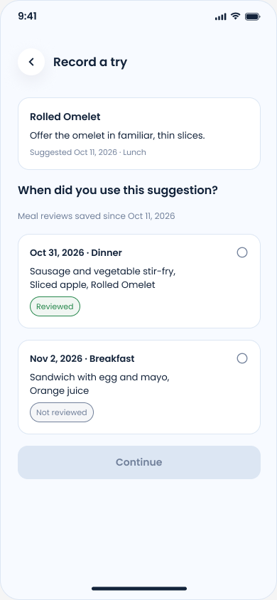

[S.06 기록 선택](https://www.figma.com/design/mxsRk3PMmZGuNpJVeAiRi5?node-id=622-362)

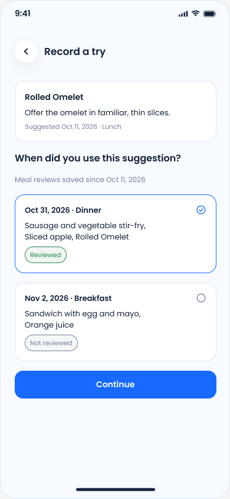

word description

### default

| 항목 | 기본 표시 |
| --- | --- |
| 추천 정보 | 음식명, 추천 미리보기, 추천의 출처 날짜와 식사 때를 보여준다. |
| 식사 기록 목록 | `When did you use this suggestion?`과 식사 날짜·종류·음식명·`Reviewed` / `Not reviewed`를 보여준다. 기록 중 추천 생성 시각 이후에 최초 저장된 기록만 식사 날짜 내림차순으로 보여준다. |
| 버튼과 선택 | 뒤로가기와 `Continue`를 보여준다. 처음에는 선택된 식사가 없고 `Continue`는 비활성화한다. |

### 상태

| 조건 | 상태 |
| --- | --- |
| 식사 한 개 선택 | 선택한 식사를 표시하고 `Continue`를 활성화한다. 다른 식사를 고르면 이전 선택을 해제한다. |
| 식사 검토가 작성되지 않은 기록 | `Not reviewed`로 표시한다. 해당 기록도 선택할 수 있다. |
| 조건을 만족하는 식사가 없음 | 식사 기록 대신 `No eligible meal records yet`을 보여준다. |
| 기록 목록 조회 중 | 로딩 표시를 보여주고 `Continue`를 비활성화한다. 조회가 끝나기 전에는 기록이 없다는 안내를 보여주지 않는다. |

### 동작

| 조건 | 동작 |
| --- | --- |
| 식사 기록 클릭 | 해당 식사 하나를 선택한다.  |
| `Continue` 클릭 | 선택한 식사로 `Link record (confirm and link)`를 연다. |
| 뒤로가기 / Android 뒤로가기 | 추천 상세 바텀시트로 돌아간다. 시도 기록은 저장하지 않는다. |
| 조회 실패 후 `Retry` 클릭 | 식사 기록을 다시 조회한다.  |

### 에러

| 조건 | 내용 |
| --- | --- |
| 기록 조회 실패 | `Meal records couldn't be loaded. Please try again.`과 `Retry`를 보여준다. 최신 목록을 받기 전에는 `Continue`를 비활성화한다. |

## Link record (confirm and link)

Figma

[S.07 음식 확인](https://www.figma.com/design/mxsRk3PMmZGuNpJVeAiRi5?node-id=622-422)

image

](images/image-27.png)

word description

### default

| 항목 | 기본 표시 |
| --- | --- |
| 추천과 선택한 식사 | 추천 요약, `Confirm this try` 섹션에서 `Selected record`— 선택한 식사의 날짜,식사 때, 음식 및 추적 재료—를 보여준다. |
| 적용 대상 목록 | `Which food did you use it for?` 아래에 선택한 식사의 음식 및 추적 재료들을 보여준다. 흰색 카드 안에 왼쪽 라디오와 음식 이름만 있는 간단한 목록을 사용한다. 선택한 이름만 굵게 표시하며 Meal Check-in의 펼침 음식 카드·조리법·추가 설명·Edit을 재사용하지 않는다. |
| 버튼과 선택 | `Change`, `Confirm & Link Record`, 뒤로가기를 보여준다. 처음에는 선택된 음식이 없고 `Confirm & Link Record`는 비활성화한다. |

### 상태

| 조건 | 상태 |
| --- | --- |
| 음식 또는 추적 재료 한 개 선택 | 선택한 대상을 표시하고 `Confirm & Link Record`를 활성화한다. 다른 대상을 고르면 이전 선택을 해제한다. 음식과 재료를 동시에 선택할 수 없다. |
| 추적 재료가 없음 | 음식만 보여준다. 음식 선택과 시도 기록은 가능하다. |
| 시도 기록 저장 중 | `Confirm & Link Record`를 비활성화하고 중복 요청을 막는다. 성공 전까지 현재 선택을 유지한다. |

### 동작

| 조건 | 동작 |
| --- | --- |
| 음식 / 추적 재료 클릭 | 추천을 실제로 적용한 대상 하나를 선택한다. |
| Confirm & Link Record 클릭 | 추천과 선택한 식사·적용 대상을 연결해 시도를 저장한다. 성공하면 Try record feedback으로 이동한다.  |
| `Change` 클릭 / 뒤로가기 / Android 뒤로가기 | `Link record (select meal)`로 돌아가 기존 식사 선택을 유지한다. 이전 음식 선택 상태는 지운다. |
| 음식이 없는 경우 Edit meal 클릭 | 선택한 식사의 음식 편집으로 이동한다. 편집을 저장하고 돌아오면 목록을 갱신하고 사라진 선택을 해제한다. |

### 에러

| 조건 | 내용 |
| --- | --- |
| 선택한 식사나 음식이 삭제·변경되거나 접근 불가 | `The selected record has changed. Select it again.`을 보여준다. 목록을 갱신하고 선택을 해제한다.  |
| 시도 기록 저장 실패 | `Your try couldn't be recorded. Please try again.`을 보여준다. 선택을 유지하고 다시 시도할 수 있다. 성공 화면이나 `Tried`를 보여주지 않는다. |

## Try record feedback

Figma

[S.08 도움 여부](https://www.figma.com/design/mxsRk3PMmZGuNpJVeAiRi5?node-id=622-482)

[Not helpful 선택](https://www.figma.com/design/mxsRk3PMmZGuNpJVeAiRi5?node-id=632-2)

[Not sure 선택](https://www.figma.com/design/mxsRk3PMmZGuNpJVeAiRi5?node-id=632-41)

image

[S.08 도움 여부](https://www.figma.com/design/mxsRk3PMmZGuNpJVeAiRi5?node-id=622-482)

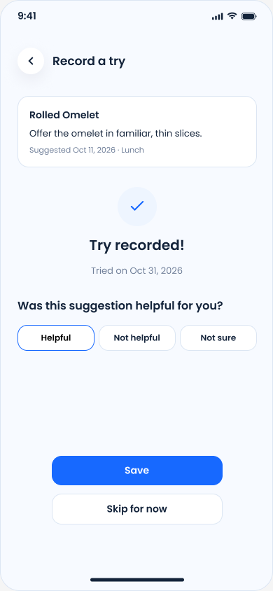

[Not helpful 선택](https://www.figma.com/design/mxsRk3PMmZGuNpJVeAiRi5?node-id=632-2)

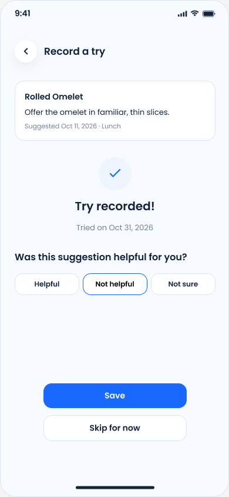

[Not sure 선택](https://www.figma.com/design/mxsRk3PMmZGuNpJVeAiRi5?node-id=632-41)

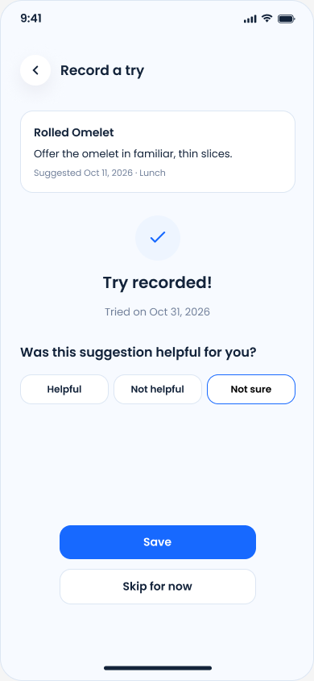

word description

### default

| 항목 | 기본 표시 |
| --- | --- |
| 시도 완료 정보 | 추천 요약, `Try recorded!`, `Tried on` 날짜를 보여준다. 이 화면에 진입할 때 시도 기록은 이미 저장된 상태다. |
| 피드백 | `Helpful`, `Not helpful`, `Not sure`를 보여준다. 처음에는 선택된 항목이 없다. |
| 버튼 | `Save`, `Skip for now`, 뒤로가기를 보여준다. `Save`는 비활성화한다. |

### 상태

| 조건 | 상태 |
| --- | --- |
| 피드백 한 개 선택 | 선택한 항목을 표시하고 `Save`를 활성화한다. 다른 항목을 누르면 선택을 바꾼다. |
| 피드백 저장 중 | `Save`를 비활성화한다.  |

### 동작

| 조건 | 동작 |
| --- | --- |
| `Helpful` / `Not helpful` / `Not sure` 클릭 | 피드백 하나를 선택한다. |
| `Save` 클릭 | 선택한 피드백를 해당 시도에 저장하고 `Saved Suggestions` 탭으로 이동한다. 해당 추천에 `Tried`를 보여준다. |
| `Skip for now` 클릭 | 선택했지만 저장하지 않은 피드백은 버리고 `Saved Suggestions` 탭으로 이동한다. 추천 시도 기록(trial)과 기존에 저장된 피드백은 유지한다. |
| 뒤로가기 / Android 뒤로가기 | 저장되지 않은 피드백은 버리고 `Saved Suggestions` 탭으로 이동한다. 추천 시도 기록(trial)은 유지한다. |

### 에러

| 조건 | 내용 |
| --- | --- |
| 피드백 저장 실패 | `Feedback couldn't be saved. Please try again.`을 보여준다. 선택과 이미 저장된 시도는 유지한다. `Save`로 다시 시도하거나 `Skip for now`로 나갈 수 있다. |

## 공통 규칙

### 카드 표시와 조작

- 카드 덱에는 실제 생성된 유효한 제안만 표시한다. 디자인 예시나 검증되지 않은 후보를 실제 추천으로 채우지 않는다. 카드 본문과 출처 표시는 [추천 정책의 제안 내용과 근거](../../../server/docs/recommendation-policy.md#r3--제안-내용과-근거)를 따른다.
- 저장·제외 버튼과 같은 방향의 스와이프는 같은 결과를 낸다. 버튼과 스와이프를 거의 동시에 사용해도 한 번에 카드 하나만 처리하며, 처리 중에는 중복 입력을 막는다.
- 저장 성공 후에만 저장된 추천 목록과 Meal Check-in의 추천 연결에서 사용할 수 있다. 제외하거나 아직 처리하지 않은 카드는 저장된 추천으로 표시하지 않는다.
- 화면을 나가거나 뒤로 이동해도 확정된 선택은 유지한다. 선택을 취소하는 동작은 Undo다. 처리 실패 시 현재 카드·선택·처리 이력을 유지하고 재시도할 수 있다.
- 저장·제외는 색뿐 아니라 아이콘과 접근성 설명으로 구분한다. 작은 화면에서도 추천 이유와 제공 팁을 읽고 두 동작에 접근할 수 있다.

### 상태와 구현 구조

- 최초 조회·생성 중·추천 불가·요청 실패를 구분한다. 추천 불가 사유와 재시도·입력 확인 경로는 [추천 정책의 상태 규칙](../../../server/docs/recommendation-policy.md#r4--추천-불가로딩오류-상태)을 따른다. 제공할 카드가 없어도 저장된 식후 검토와 결과를 유지한다.
- 조회·생성 중 식사·프로필이 변경되거나 화면을 나가면 오래된 응답으로 현재 카드 상태를 덮어쓰지 않는다.
- 화면 상태는 TypeScript 타입으로 정의한다. Screen·Feature Hook·Query·API의 책임과 UI의 데이터 접근 제한은 [클라이언트 아키텍처](../../docs/architecture.md)를 따른다. 테스트 대역을 사용해도 같은 정책과 상태 규칙을 적용한다.
- 모든 화면 문구는 `util/strings.ts`에서 한국어·영어로 관리하고 색은 `util/colors.ts`를 사용한다. 저장된 식별자와 상태 값은 화면 언어와 분리한다.

word description

### 시간과 복원

| 조건 | 규칙 |
| --- | --- |
| 앱을 다시 실행한 경우 | 확정된 음식 선택과 카드 처리 상태를 복원한다. 카드 앞면부터 보여 주며, 시트의 임시 선택·미저장 피드백·`Undo` 이력은 복원하지 않는다. |
| 로그아웃한 경우 | 로컬에 저장되는 캐시는 계정이 바뀌면 정리한다. |
| API가 응답이 없는 경우 | 같은 요청의 결과를 먼저 확인하고 재시도한다. |

