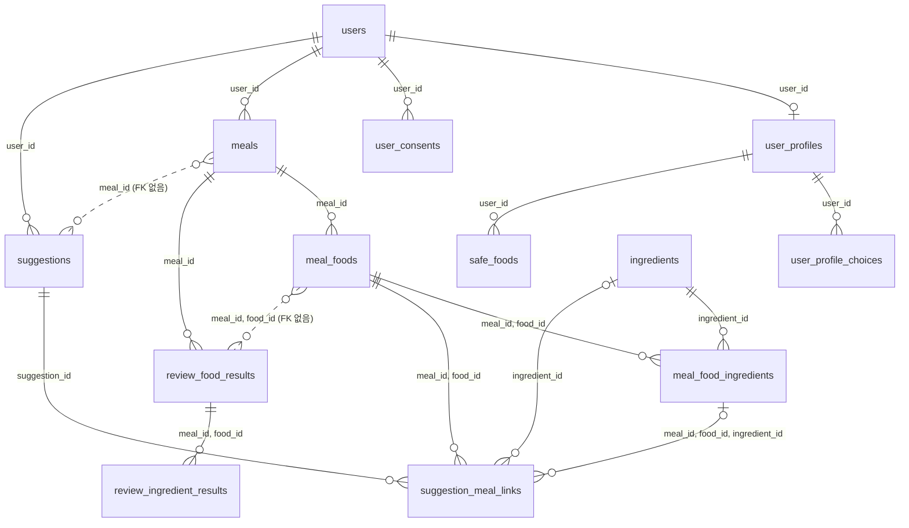

<!-- AI-generated with Claude Sonnet 5.5, 2026-10-26, reviewed by Jaemin Kim -->

# DB 스키마

서버가 쓰는 PostgreSQL 테이블이 어떻게 이루어져 있고 서로 어떻게 이어지는지 정리한다. 컬럼 하나하나는 적지 않는다. 정확한 정의는
`server/app/models/`의 모델이 기준이고, 변경 이력은 `server/migrations/versions/`에 있다. 테이블 사이의 관계나 키를 바꾸면 이 문서도 같은
변경에서 함께 고쳐야 한다.

## 1. 개요

테이블은 13개이고 네 묶음으로 나뉜다.

| 묶음 | 테이블 | 한 줄 설명 |
|---|---|---|
| 사용자 · 온보딩 | `users`, `user_profiles`, `user_profile_choices`, `safe_foods`, `user_consents` | 계정, 아이 프로필과 선택 항목, 잘 먹는 음식, 동의 기록 |
| 식사 기록 | `meals`, `meal_foods`, `meal_food_ingredients`, `ingredients` | 식사와 그 안의 음식 · 재료, 공용 재료 |
| 식사 후 리뷰 | `review_food_results`, `review_ingredient_results` | 음식 · 재료별 먹은 결과와 어려웠던 점 |
| 추천 | `suggestions`, `suggestion_meal_links` | 생성한 추천, 이후 식사와의 연결 |

## 2. 모델 관계

실선은 외래 키(FK)로 이어진 관계이고, 점선은 값만 같을 뿐 외래 키가 없는 관계다.

기본키가 여러 컬럼인 테이블은 다음과 같다.

| 테이블 | 기본키 |
|---|---|
| `meal_foods` | (`meal_id`, `id`) |
| `meal_food_ingredients` | (`meal_id`, `food_id`, `ingredient_id`) |
| `review_food_results` | (`meal_id`, `food_id`) |
| `review_ingredient_results` | (`meal_id`, `food_id`, `ingredient_id`) |
| `user_profile_choices` | (`user_id`, `category`, `position`) |
| `user_profiles` | `user_id` |

## 3. 이해하는 데 유의해야 할 사항

### 3.1 `food_id`는 식사 안에서만 고유하다

음식(`meal_foods`)의 기본키는 (`meal_id`, `id`)이고, `id`는 식사를 저장할 때 **클라이언트가 붙여서 보내는 값**이다. 그래서 다른 식사의 음식과
같은 `food_id`를 가질 수 있고, `food_id` 하나만으로는 음식을 가리킬 수 없다. 음식을 가리키려면 항상 `meal_id`와 함께 써야 한다.
같은 이유로 `review_food_results`, `meal_food_ingredients`, `suggestion_meal_links`도 `meal_id`를 `food_id`와 함께 키로 쓴다.

### 3.2 공용 `ingredients`의 용도

`ingredients`는 모든 사용자가 함께 쓰는 공용 재료 테이블이고 이름이 유일하다. 팀 합의에 따라 이 테이블은 **아이의 제한(restriction)에 어긋나는
재료나 음식을 추천하지 않기 위한 목적으로만** 쓰고, 사용자의 리뷰 정보와 연동하지 않는다.

### 3.3 리뷰 결과는 저장 시점의 스냅샷을 담는다

`review_food_results.food_snapshot`은 리뷰를 저장할 때의 음식 이름, 재료(`{id, name}`), 조리법, 담은 방식 메모, 수용도를 JSON으로 복사해 둔 것이다.
리뷰 이후에 식사 기록이 바뀌어도 리뷰 결과는 그때의 값을 유지한다. 이를 위해 `review_food_results`의 `food_id`는 `meal_foods`를 외래 키로
참조하지 않고, `review_ingredient_results`의 `ingredient_id`도 `ingredients`를 참조하지 않는다. 같은 식사의 리뷰를 다시 저장하면 기존 결과를
지우고 새로 만든다.

### 3.4 `suggestions`는 식사 · 음식 · 재료를 값으로만 갖는다

`suggestions`의 `meal_id`, `food_id`, `ingredient_id`는 외래 키가 아닌 일반 컬럼이다. 추천을 만든 근거가 된 음식은 `food_snapshot`(JSON)으로
함께 저장한다. 이 `meal_id`는 추천을 **만든 식사**다.

### 3.5 추천이 연결된 식사는 `suggestion_meal_links`에 따로 있다

`suggestion_meal_links`는 저장한 추천을 **이후 식사에서 시도했을 때** 그 식사의 음식(과 선택적으로 재료)에 연결하고, 도움이 되었는지
`feedback`(`helpful` · `not_helpful` · `not_sure`)을 남긴다. 여기의 `meal_id`는 추천을 만든 식사가 아니라 시도한 식사이고, 그 식사의
`meal_foods`(와 `meal_food_ingredients`)를 외래 키로 참조한다. 한 식사에서 같은 추천을 두 번 연결할 수 없다 (`meal_id`, `suggestion_id` 유일).

### 3.6 프로필 선택 항목은 `code`와 `custom_name` 중 하나만 갖는다

`user_profile_choices`의 한 행은 고른 옵션의 `code`이거나 직접 입력한 `custom_name`이다. 둘 다 있거나 둘 다 없는 행은 만들 수 없다.
`category`는 `allergy` · `restriction` · `family_food` · `dietary_approach` · `difficult_texture` · `difficult_taste` ·
`presentation_preference` 중 하나이고, 같은 분류 안의 순서는 `position`이 나타낸다. 프로필의 `allergy_status` · `restriction_status` ·
`safe_food_status`는 선택 항목이 있는지를 나타내는 상태 값이다.

### 3.7 동의 기록은 덧붙이기만 한다

`user_consents`는 수정하지 않고 새 행을 추가한다. 종류(`kind`)별 현재 상태는 가장 최근 행이다.

### 3.8 id는 DB에서는 숫자, API에서는 문자열이다

모든 id는 `BIGINT`이고, API로 주고받을 때는 문자열로 바꾼다. 사용자를 지우면 `users`를 따라가는 행이 연쇄로 지워진다.
