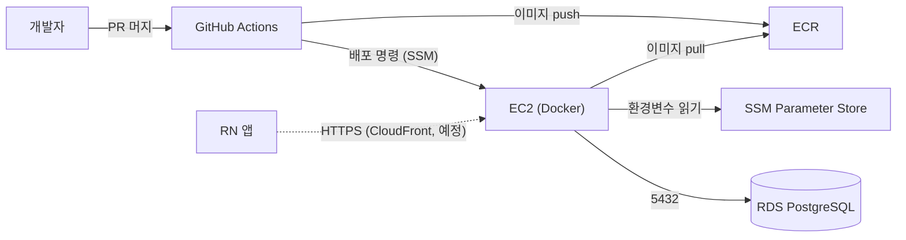
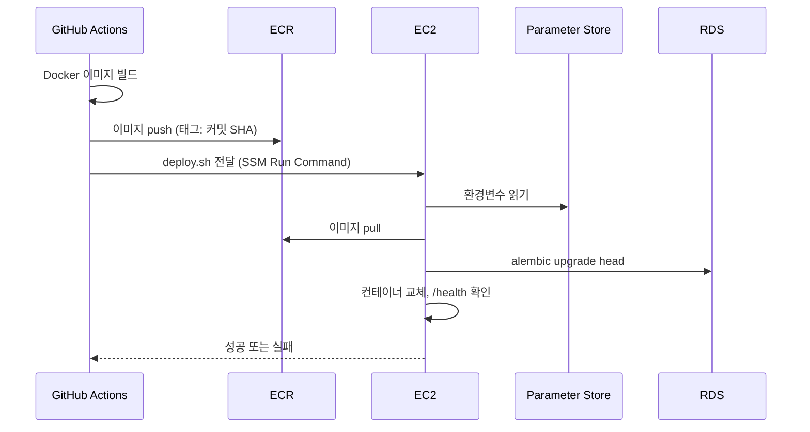

<!-- AI-generated with Claude Sonnet 5.5, 2026-10-17, reviewed by Jaemin Kim -->
# 서버 배포 가이드

서버(`server/`)를 AWS에 배포하는 구조와 설정 방법을 설명합니다. 코드 구조는 [architecture.md](architecture.md), 로컬 실행은 [README](../README.md)를 참고하세요.

## 1. 개요

`main` 브랜치에 `server/` 변경이 머지되면 GitHub Actions가 Docker 이미지를 만들어 AWS ECR에 올리고, EC2에서 새 이미지를 실행합니다. 데이터베이스는 RDS의 PostgreSQL입니다.



### 구성 요소

| 구성 요소 | 이름 | 하는 일 |
| --- | --- | --- |
| 리전 | `ap-southeast-2` (시드니) | 아래 리소스가 모두 이 리전에 있습니다. |
| EC2 | `nurturebites-server` | 서버 컨테이너를 실행합니다. SSH 대신 SSM으로 접속하며 22번 포트는 열지 않습니다. |
| RDS | `nurturebites-postgres` | PostgreSQL 16. 퍼블릭 접근을 막아 두었고 EC2의 보안그룹에서 오는 5432번만 허용합니다. |
| ECR | `nurturebites-server` | 서버 Docker 이미지 저장소. 이미지 태그는 커밋 SHA입니다. 최근 10개만 유지합니다. |
| SSM Parameter Store | `/nurturebites/prod/*` | 운영 환경변수. 비밀 값은 SecureString으로 암호화해 저장합니다. |
| GitHub Actions | `server-ci.yml`, `server-deploy.yml` | 검사와 배포를 자동화합니다. |

> CloudFront(HTTPS 주소)는 아직 구성하지 않았습니다.

## 2. 배포 흐름

자동화는 워크플로 두 개로 나뉩니다.

| 워크플로 | 파일 | 실행 시점 | 하는 일 |
| --- | --- | --- | --- |
| Server CI | `.github/workflows/server-ci.yml` | `server/`가 바뀐 PR | 코드 검사와 테스트 |
| Server Deploy | `.github/workflows/server-deploy.yml` | `main`에 `server/` 변경 머지 (수동 실행도 가능) | 이미지 빌드와 EC2 배포 |

### 2.1 CI (PR)

PR이 열리거나 갱신될 때 `server/`에서 아래를 순서대로 실행합니다. 하나라도 실패하면 PR에 빨간 표시가 뜹니다.

1. `ruff check .` — 코드 규칙 검사
2. `ruff format --check .` — 코드 서식 검사
3. `pytest` — 테스트. 인메모리 SQLite를 쓰므로 DB나 환경변수 설정이 필요 없습니다.

PR을 올리기 전에 `server/`에서 같은 명령을 실행하면 CI 결과를 미리 알 수 있습니다.

### 2.2 배포 (main 머지)



GitHub Actions 쪽 단계는 이렇습니다.

1. OIDC로 AWS 역할을 받습니다. 장기 액세스 키를 GitHub에 저장하지 않습니다.
2. 이미지를 빌드해서 ECR에 올립니다. 태그는 커밋 SHA이므로, 어떤 이미지가 어느 커밋인지 바로 알 수 있습니다.
3. `server/deploy/deploy.sh`를 SSM으로 EC2에 보내 실행하고, 끝날 때까지(최대 10분) 기다립니다. EC2의 출력은 Actions 로그에 그대로 나옵니다. 성공이 아니면 워크플로가 실패합니다.

EC2에서 `deploy.sh`가 하는 일은 이렇습니다.

1. SSM Parameter Store의 `/nurturebites/prod/*` 값을 읽어 임시 환경변수 파일을 만듭니다. 필수 파라미터(`ENVIRONMENT`, `JWT_SECRET_KEY`, `POSTGRES_HOST`, `POSTGRES_USER`, `POSTGRES_PASSWORD`, `POSTGRES_DB`)가 하나라도 없거나 비어 있거나, `ENVIRONMENT`가 `production`이 아니면 중단합니다.
2. 새 이미지를 pull합니다.
3. 새 이미지로 `alembic upgrade head`를 실행해 DB 마이그레이션을 적용합니다.
4. 실행 중인 컨테이너를 지우고 새 컨테이너를 띄웁니다.
5. `/health`가 응답하는지 최대 60초 동안 확인합니다. 응답하면 배포 성공입니다.
6. 응답하지 않으면 컨테이너 로그를 남기고 **이전 이미지로 되돌린 뒤** 배포를 실패 처리합니다.

한 번에 배포는 하나만 실행됩니다. 앞선 배포가 끝나기 전에 또 머지되면 뒤의 배포가 기다렸다가 실행됩니다.

### 2.3 워크플로가 읽는 GitHub Variables

레포의 Settings → Secrets and variables → Actions → Variables에 등록되어 있습니다. 비밀 값이 아니라서 Secrets가 아닌 Variables를 씁니다.

| 이름 | 의미 |
| --- | --- |
| `AWS_REGION` | AWS 리전 |
| `AWS_ROLE_ARN` | 워크플로가 받는 AWS 역할 (ECR push, SSM 명령 전송 권한) |
| `ECR_REPOSITORY` | ECR 저장소 이름 |
| `EC2_INSTANCE_ID` | 배포 대상 EC2 인스턴스 ID |

DB 비밀번호나 JWT 키 같은 비밀 값은 GitHub에 없고, EC2가 배포할 때 Parameter Store에서 직접 읽습니다. 설정 방법은 [3. 환경변수 설정법](#3-환경변수-설정법)을 참고하세요.

## 3. 환경변수 설정법

서버는 `app/core/config.py`의 `Settings`로 설정을 읽습니다. 환경변수가 `.env` 파일보다 우선하고, 둘 다 없으면 코드의 기본값을 씁니다. 코드는 환경에 관계없이 같고, 값이 오는 곳만 다릅니다.

| 환경 | 값이 오는 곳 | 할 일 |
| --- | --- | --- |
| 로컬 개발 | `server/.env` | `.env.example`을 복사해서 씁니다. `.env`는 커밋되지 않습니다. `ENVIRONMENT`는 `local`로 둡니다. |
| 테스트, CI | 없음 | 테스트가 DB를 인메모리 SQLite로 바꿔 끼우므로 설정이 필요 없습니다. |
| 운영 (EC2) | SSM Parameter Store `/nurturebites/prod/*` | 아래 설명을 따릅니다. |

### 3.1 운영 변수 목록

파라미터 이름의 **마지막 부분이 환경변수 이름**이 됩니다. 예를 들어 `/nurturebites/prod/POSTGRES_HOST`는 `POSTGRES_HOST`로 컨테이너에 전달됩니다.

| 이름 | 종류 | 설명 |
| --- | --- | --- |
| `ENVIRONMENT` | String | 운영에서는 `production`. `local`이 아니면 기본 JWT 키로는 서버가 기동하지 않습니다. |
| `DEBUG` | String | 운영에서는 `false` |
| `POSTGRES_HOST` | String | RDS 엔드포인트 |
| `POSTGRES_PORT` | String | `5432` |
| `POSTGRES_USER` | String | RDS 사용자 이름 |
| `POSTGRES_DB` | String | 데이터베이스 이름 |
| `POSTGRES_PASSWORD` | SecureString | RDS 비밀번호. **영문과 숫자로만** 구성합니다. `@`, `/`, `:`, `#` 같은 문자가 있으면 DB 접속 주소가 깨집니다. |
| `JWT_SECRET_KEY` | SecureString | 로그인 토큰 서명 키. `openssl rand -hex 32`로 만든 값을 씁니다. |

`SecureString`은 암호화되어 저장되고, EC2가 배포할 때만 복호화해서 읽습니다. 비밀 값은 채팅, 이슈, 커밋에 올리지 마세요.

### 3.2 값 확인과 변경

AWS 콘솔의 Systems Manager → Parameter Store에서 보거나 고칠 수 있고, CLI로는 이렇게 합니다. 모든 명령에 `--region ap-southeast-2`가 필요합니다.

```bash
# 어떤 파라미터가 있는지 확인 (값은 출력하지 않음)
aws ssm get-parameters-by-path --region ap-southeast-2 --path /nurturebites/prod \
  --query 'Parameters[].Name'

# 값 변경 (일반 값)
aws ssm put-parameter --region ap-southeast-2 --type String --overwrite \
  --name /nurturebites/prod/DEBUG --value false
```

비밀 값은 CLI 인자로 쓰면 셸 기록에 남으므로 콘솔에서 바꾸는 것을 권합니다.

**값을 바꿨다고 실행 중인 서버에 바로 반영되지는 않습니다.** 컨테이너는 시작할 때 값을 한 번 읽기 때문에, GitHub의 Actions 탭 → Server Deploy → Run workflow로 다시 배포해야 새 값이 적용됩니다.

### 3.3 새 환경변수를 추가할 때

1. `Settings`에 필드를 추가하고 `.env.example`에도 같은 이름을 추가합니다.
2. 같은 이름으로 Parameter Store에 `/nurturebites/prod/<이름>`을 **먼저** 등록합니다.
3. 그 뒤에 PR을 머지합니다. 등록 전에 배포되면, 기본값이 없는 필드는 서버가 기동하지 못하고 배포가 실패합니다. 이때는 이전 이미지로 되돌아가므로 서비스가 멈추지는 않습니다.

## 4. 운영

### 4.1 서버 접속

SSH는 쓰지 않습니다(22번 포트가 닫혀 있고 키도 없습니다). AWS 콘솔에서 EC2 → 인스턴스 선택 → 연결 → **세션 관리자** 탭으로 접속합니다. 접속하려면 AWS 계정에 해당 권한이 있어야 합니다.

접속한 사용자는 `ssm-user`이므로 Docker 명령 앞에 `sudo`를 붙입니다.

### 4.2 상태와 로그 확인

서버는 `nurturebites-server`라는 이름의 Docker 컨테이너로 실행되고, 8000번 포트를 씁니다.

```bash
sudo docker ps                                   # 컨테이너가 떠 있는지
sudo docker logs --tail 100 nurturebites-server  # 최근 로그 (-f 를 붙이면 계속 따라감)
curl -s localhost:8000/health                    # 서버가 응답하는지
```

보안그룹이 CloudFront의 접속만 허용하도록 설계되어 있어, EC2 밖에서는 8000번 포트로 직접 접속할 수 없습니다. 헬스체크는 서버 안에서 확인합니다.

컨테이너는 `--restart unless-stopped`로 실행하고 Docker 서비스도 부팅 때 자동으로 시작하므로, 인스턴스를 재부팅하면 서버도 저절로 다시 뜹니다. 수동으로 재시작하려면 `sudo docker restart nurturebites-server`를 실행합니다.

### 4.3 배포가 실패했을 때

Actions 탭에서 실패한 Server Deploy 실행을 열고 **"EC2 에 배포 (SSM)"** 단계의 `deploy 출력`을 봅니다. EC2에서 `deploy.sh`가 출력한 내용이 그대로 들어 있습니다.

| 증상 | 의심할 것 |
| --- | --- |
| `SSM 경로 ... 에서 파라미터를 읽지 못했습니다` | Parameter Store에 값이 없거나, EC2 역할의 읽기 권한이 없습니다. |
| `docker pull` 또는 ECR 로그인 오류 | EC2 역할의 ECR 읽기 권한을 확인합니다. |
| `alembic upgrade head`에서 오류 | 마이그레이션 코드 문제이거나 RDS에 접속하지 못한 경우입니다. 이 단계에서 실패하면 기존 컨테이너는 그대로 실행 중입니다. |
| `헬스체크 실패` | 컨테이너 로그가 함께 출력됩니다. 이전 이미지로 자동으로 되돌아갑니다. |
| 워크플로가 AWS 인증 단계에서 실패 | GitHub Variables 값(`AWS_ROLE_ARN` 등)과 AWS 역할의 신뢰 정책을 확인합니다. |

### 4.4 이전 버전으로 되돌리기

문제가 있는 변경을 **되돌리는 PR(revert)을 만들어 머지**합니다. 머지하면 평소처럼 자동으로 배포되어, 이전 코드가 새 이미지로 다시 올라갑니다. 급할 때는 팀 규칙에 따라 리뷰를 최소화하고 바로 머지하세요.

되돌려도 **DB 마이그레이션은 되돌아가지 않습니다.** 이미 적용된 스키마 변경은 남으므로, 마이그레이션이 포함된 변경을 되돌릴 때는 DB를 어떻게 맞출지 팀에서 먼저 확인하세요. 마이그레이션을 되돌리는 `alembic downgrade`는 데이터를 지울 수 있어 자동으로 실행하지 않습니다.

### 4.5 DB 직접 확인

RDS는 외부에 공개되어 있지 않아서 EC2에서만 접속할 수 있습니다. 세션 관리자로 접속한 뒤 실행합니다.

```bash
sudo dnf install -y postgresql16        # psql 이 없을 때만 (한 번만 설치하면 됨)
psql -h <RDS 엔드포인트> -U <사용자> -d <DB 이름>   # 비밀번호는 프롬프트에 입력
```

운영 DB의 데이터를 직접 수정하는 작업(`UPDATE`, `DELETE` 등)은 팀원에게 알리고 진행하세요.

## 5. 기타: 알려진 한계와 남은 일

| 항목 | 내용 |
| --- | --- |
| HTTPS 주소 없음 | CloudFront를 아직 구성하지 않아서 앱이 접속할 HTTPS 주소가 없습니다. 구성할 때는 EC2의 8000번 포트를 CloudFront에서 오는 요청만 받도록 열어 둡니다. |
| 배포 중 짧은 중단 | 서버가 1대라서 컨테이너를 교체하는 몇 초 동안 요청이 실패할 수 있습니다. |
| 단일 장애 지점 | EC2와 RDS가 각각 1대(단일 AZ)입니다. 장애가 나면 수동으로 복구해야 합니다. |
| Dockerfile 검증 시점 | CI는 이미지를 빌드하지 않습니다. `Dockerfile`을 고친 PR의 빌드 오류는 머지 후 배포 단계에서야 드러나므로, 고쳤다면 로컬에서 `docker build server`로 먼저 확인하세요. |
| DB 비밀번호 문자 제한 | `database_url`이 비밀번호를 URL 인코딩하지 않아서, 특수문자가 있으면 접속 주소가 깨집니다. 그래서 비밀번호를 영문과 숫자로만 만듭니다. |
| DB 접속 암호화 미강제 | 접속 설정에 `sslmode`가 없어 기본값(`prefer`)으로 동작합니다. 연결은 되지만 암호화를 강제하지 않습니다. |
| 공개 전 확인 | CORS가 모든 출처를 허용(`allow_origins=["*"]`)합니다. `meal_logs` 엔드포인트는 현재 로그인 검사(`CurrentUser`)를 받지 않습니다. 외부에 공개하기 전에 팀에서 정리가 필요합니다. |
