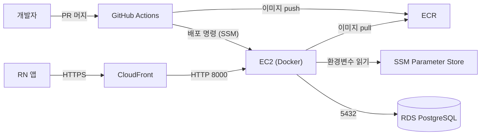
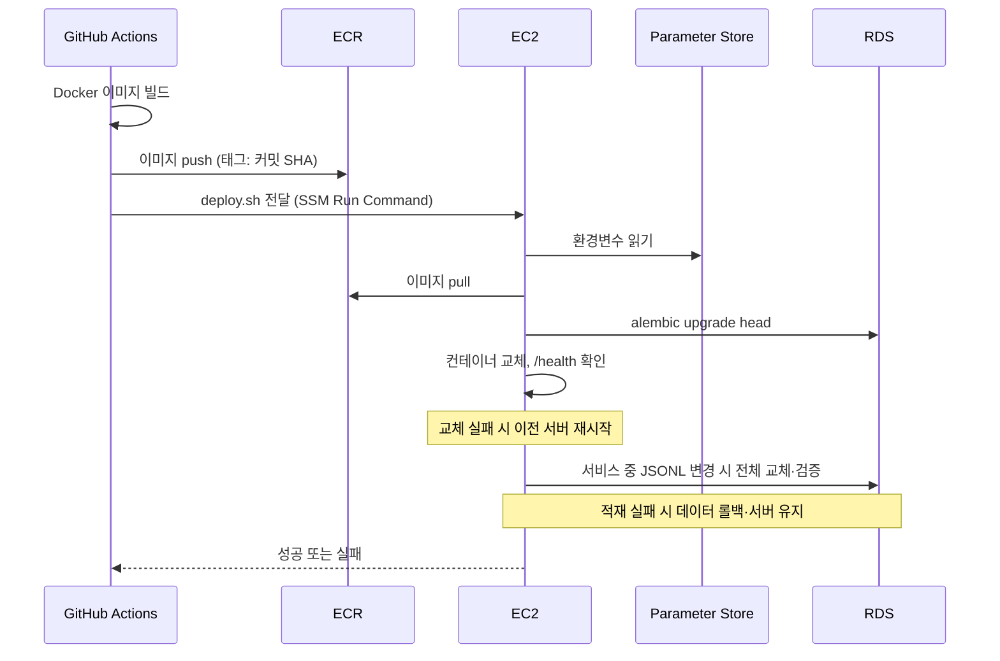

<!-- AI-generated with Claude Sonnet 5.5, 2026-10-17, reviewed by Jaemin Kim -->
<!-- Changed: deploy 관련 문서 추가 -->
<!-- AI-generated with Claude Sonnet 5.5, 2026-10-19, reviewed by Jaemin Kim -->
<!-- Changed: suggestion 관련 문서 업데이트 -->
<!-- AI-generated with GPT-6, 2026-10-26, reviewed by Haechan Jung -->
<!-- Changed: 식사 API 인증 설명 수정 -->

<!-- AI-generated with GPT-6, 2026-10-30, reviewed by Seoyeon Heo -->
<!-- Changed: 클라이언트 API 통합 CI 설명 -->

<!-- AI-generated with GPT-6, 2026-11-04, reviewed by Haechan Jung -->
<!-- Changed: 전용 API 검사 제거에 맞춘 Client CI 안내 -->
<!-- AI-generated with GPT-6, 2026-11-11, reviewed by Haechan Jung -->
<!-- Changed: 서버 교체 후 적재와 실패 시 서비스 유지 절차 정의 -->

# 서버 배포 가이드

서버(`server/`)를 AWS에 배포하는 구조와 설정 방법을 설명합니다. 코드 구조는 [architecture.md](architecture.md), 로컬 실행은 [README](../README.md)를 참고하세요.

## 1. 개요

`main` 브랜치에 서버 코드 또는 최종 재료 JSONL 변경이 머지되면 GitHub Actions가 Docker 이미지를 만들어 AWS ECR에 올리고, EC2에서 새 이미지를 실행합니다. 데이터베이스는 RDS의 PostgreSQL입니다.



### 구성 요소

| 구성 요소 | 이름 | 하는 일 |
| --- | --- | --- |
| 리전 | `ap-southeast-2` (시드니) | 아래 리소스가 모두 이 리전에 있습니다. |
| EC2 | `nurturebites-server` | 서버 컨테이너를 실행합니다. SSH 대신 SSM으로 접속하며 22번 포트는 열지 않습니다. |
| RDS | `nurturebites-postgres` | PostgreSQL 16. 퍼블릭 접근을 막아 두었고 EC2의 보안그룹에서 오는 5432번만 허용합니다. |
| ECR | `nurturebites-server` | 서버 Docker 이미지 저장소. 이미지 태그는 커밋 SHA입니다. 최근 10개만 유지합니다. |
| SSM Parameter Store | `/nurturebites/prod/*` | 운영 환경변수. 비밀 값은 SecureString으로 암호화해 저장합니다. |
| CloudFront | `https://d22rvdcyrf0azy.cloudfront.net` | 앱이 접속하는 HTTPS 주소입니다. EC2의 8000번 포트로 요청을 전달합니다. 캐시는 끄고(`CachingDisabled`), `Authorization` 헤더를 포함한 요청 헤더를 그대로 전달하며, PUT·DELETE 등 모든 메서드를 허용합니다. |
| GitHub Actions | `server-ci.yml`, `server-deploy.yml` | 검사와 배포를 자동화합니다. |

EC2의 8000번 포트는 CloudFront에서 오는 요청만 받도록 보안그룹을 설정해 두었습니다. 그래서 EC2의 IP로 직접 접속하는 것은 막혀 있고, 앱의 API 주소는 항상 위 CloudFront 주소입니다 (예: `https://d22rvdcyrf0azy.cloudfront.net/api/v1/auth/login`).

## 2. 배포 흐름

자동화는 워크플로 두 개로 나뉩니다.

| 워크플로 | 파일 | 실행 시점 | 하는 일 |
| --- | --- | --- | --- |
| Server CI | `.github/workflows/server-ci.yml` | 서버·재료 데이터·공통 제한 규칙이 바뀐 PR | 코드·데이터 검사와 테스트 |
| Server Deploy | `.github/workflows/server-deploy.yml` | `main`에 서버·최종 재료 JSONL 변경 머지 (수동 실행도 가능) | 이미지 빌드·재료 적재·EC2 배포 |

### 2.1 CI (PR)

PR이 열리거나 갱신될 때 아래 검사를 순서대로 실행한다. 실행 위치를 따로 적지 않은 명령은
`server/` 기준이다. 하나라도 실패하면 CI가 실패한다.

1. `ruff check . ../data/ingredient_db` — 서버·재료 생성 코드 검사
2. `ruff format --check . ../data/ingredient_db` — 코드 서식 검사
3. `python -m unittest discover -s data/ingredient_db/tests` — 가짜 Gemini로 생성 과정 검사. 저장소 루트에서 실행한다.
4. `python -m data.ingredient_db check` — 검토 기록과 최종 JSONL 검사. 저장소 루트에서 실행한다.
5. `pytest` — 서버 테스트. 인메모리 SQLite를 사용하며 운영 DB에는 접속하지 않는다.
6. 저장소 루트에서 최종 JSONL 두 파일을 `server/assets/`에 복사하고 `docker build -t server-check server`로 빌드한다. 이미지의 적재기는 `assets/`의 파일을 `--check`로 검사한다.

PR을 올리기 전에 각 명령의 실행 위치에서 같은 검사를 수행한다.

Client CI는 `client/` 또는 해당 워크플로 파일이 바뀐 PR에서 실행한다.
루트·Unit·Integration 클라이언트 테스트와 린트·타입 검사를 수행한다.

### 2.2 배포 (main 머지)

CI와 CD는 빌드 직전에 `data/ingredient_db/result/`의 JSONL 두 파일을 `server/assets/`에 복사한다.
배포 이미지는 서버 코드, 적재기와 이 두 파일을 함께 담는다. 복사본은 Git에 넣지 않는다.
재료 생성 코드·원본 다운로드·Gemini 응답·검토 기록·비밀 파일은 이미지에 넣지 않는다.
빌드 컨텍스트는 `server/`, 이미지의 작업 디렉터리는 `/app`이다. 로컬 복사·빌드 명령은
[서버 README](../README.md#의존성과-빌드)를 따른다. 이미지 안의 적재 명령은
`--ingredients assets/ingredients.jsonl --restrictions assets/ingredients_restrictions.jsonl`로 입력을 지정한다.

공용 재료는 Git의 JSONL을 기준으로 관리하며 운영 API는 읽기만 한다.
배포 적재기는 마지막 적재 해시와 두 파일의 해시를 비교한다. 최초 적재 또는 파일 변경 시
공용 재료·제한 판정을 전부 교체하고 해시를 같은 DB 트랜잭션에 기록한다. 같으면 교체를 건너뛴다.
재료 생성 API는 배포에서 호출하지 않는다. 수동 검사·적재 명령은
[재료 데이터 안내](../../data/ingredient_db/README.md#서버-적용)에 둔다.

준비 작업 동안 기존 서버를 유지하고, 컨테이너를 교체하는 순간에만 짧은 중단이 발생한다.
새 서버는 영어 이름을 우선하며 적재 전에는 기존 한국어 이름도 읽는다.
새 서버의 기동을 확인한 뒤 서버를 실행한 상태로 재료를 적재한다.
서버 교체에 실패하면 데이터 변경 전이므로 이전 이미지를 다시 실행한다.
적재 중 오류는 트랜잭션을 롤백하고 새 서버를 유지한다. 적재 후 검증 실패도 서버와 데이터를 유지하며
원인을 수정한 뒤 재배포한다. 사용자 식사 기록과 저장된 추천은 변경하지 않는다.



GitHub Actions 쪽 단계는 이렇습니다.

1. OIDC로 AWS 역할을 받습니다. 장기 액세스 키를 GitHub에 저장하지 않습니다.
2. 이미지를 빌드해서 ECR에 올립니다. 태그는 커밋 SHA이므로, 어떤 이미지가 어느 커밋인지 바로 알 수 있습니다.
3. `server/deploy/deploy.sh`를 SSM으로 EC2에 보내 실행하고, 끝날 때까지(최대 10분) 기다립니다. EC2의 출력은 Actions 로그에 그대로 나옵니다. 성공이 아니면 워크플로가 실패합니다.

EC2에서 `deploy.sh`는 다음 순서로 실행한다.

1. 호스트 잠금을 획득하고 SSM Parameter Store에서 운영 환경변수를 읽는다. 값은 로그에 출력하지 않는다.
2. 중단된 배포의 작업 컨테이너가 남아 있으면 종료한다.
3. 새 이미지를 받아 JSONL을 검사하고 DB 마이그레이션을 적용한다. 이 단계의 실패는 기존 서버를 중지하지 않는다.
4. 현재 이미지를 기록하고 컨테이너를 교체한다. 새 서버의 `/health` 확인에 실패하면 이전 이미지를 다시 실행한다.
5. 새 서버의 자동 재시작을 활성화한 뒤, 서버를 실행한 상태로 JSONL 변경 시 데이터를 교체한다.
6. DB 카탈로그와 이미지 JSONL의 일치를 확인한다. 적재·검증 실패는 배포 실패로 기록하되 서버를 중지하지 않는다.

GitHub Actions와 EC2 호스트 잠금으로 배포를 직렬 실행한다.
스냅샷·복구 기록은 저장하지 않는다. 배포 프로세스가 강제 종료된 경우에는 재배포한다.

### 2.3 워크플로가 읽는 GitHub Variables

레포의 Settings → Secrets and variables → Actions → Variables에 등록되어 있습니다. 비밀 값이 아니라서 Secrets가 아닌 Variables를 씁니다.

| 이름 | 의미 |
| --- | --- |
| `AWS_REGION` | AWS 리전 |
| `AWS_ROLE_ARN` | 워크플로가 받는 AWS 역할 (ECR push, SSM 명령 전송 권한) |
| `ECR_REPOSITORY` | ECR 저장소 이름 |
| `EC2_INSTANCE_ID` | 배포 대상 EC2 인스턴스 ID |

DB 비밀번호나 JWT 키 같은 비밀 값은 GitHub에 없고, EC2가 배포할 때 Parameter Store에서 직접 읽습니다. 설정 방법은 [3. 환경변수 설정법](#3-환경변수-설정법)을 참고하세요.

## 3. 환경변수 설정법

서버는 `app/core/config.py`의 `Settings`로 설정을 읽습니다. 환경변수가 `.env` 파일보다 우선하고, 둘 다 없으면 코드의 기본값을 씁니다. 코드는 환경에 관계없이 같고, 값이 오는 곳만 다릅니다.

| 환경 | 값이 오는 곳 | 할 일 |
| --- | --- | --- |
| 로컬 개발 | `server/.env` | `.env.example`을 복사해서 씁니다. `.env`는 커밋되지 않습니다. `ENVIRONMENT`는 `local`로 둡니다. |
| 테스트, CI | 없음 | 테스트가 DB를 인메모리 SQLite로 바꿔 끼우므로 설정이 필요 없습니다. |
| 운영 (EC2) | SSM Parameter Store `/nurturebites/prod/*` | 아래 설명을 따릅니다. |

### 3.1 운영 변수 목록

파라미터 이름의 **마지막 부분이 환경변수 이름**이 됩니다. 예를 들어 `/nurturebites/prod/POSTGRES_HOST`는 `POSTGRES_HOST`로 컨테이너에 전달됩니다.

| 이름 | 종류 | 설명 |
| --- | --- | --- |
| `ENVIRONMENT` | String | 운영에서는 `production`. `local`이 아니면 기본 JWT 키로는 서버가 기동하지 않습니다. |
| `DEBUG` | String | 운영에서는 `false` |
| `POSTGRES_HOST` | String | RDS 엔드포인트 |
| `POSTGRES_PORT` | String | `5432` |
| `POSTGRES_USER` | String | RDS 사용자 이름 |
| `POSTGRES_DB` | String | 데이터베이스 이름 |
| `POSTGRES_PASSWORD` | SecureString | RDS 비밀번호. **영문과 숫자로만** 구성합니다. `@`, `/`, `:`, `#` 같은 문자가 있으면 DB 접속 주소가 깨집니다. |
| `JWT_SECRET_KEY` | SecureString | 로그인 토큰 서명 키. `openssl rand -hex 32`로 만든 값을 씁니다. |
| `OPENROUTER_API_KEY` | SecureString | 제안 생성(LLM)에 쓰는 OpenRouter API 키. 필수 파라미터가 아니라서 없어도 배포와 서버 기동은 되지만, 제안 생성 요청이 실패(502 `GENERATION_FAILED`)합니다. |
| `SUGGESTION_MODEL` | String | 제안 생성에 쓰는 OpenRouter 모델 이름(`provider/model`). 생략하면 코드의 기본값(`openai/gpt-6-luna`)을 씁니다. |

`SecureString`은 암호화되어 저장되고, EC2가 배포할 때만 복호화해서 읽습니다. 비밀 값은 채팅, 이슈, 커밋에 올리지 마세요.

### 3.2 값 확인과 변경

AWS 콘솔의 Systems Manager → Parameter Store에서 보거나 고칠 수 있고, CLI로는 이렇게 합니다. 모든 명령에 `--region ap-southeast-2`가 필요합니다.

```bash
# 어떤 파라미터가 있는지 확인 (값은 출력하지 않음)
aws ssm get-parameters-by-path --region ap-southeast-2 --path /nurturebites/prod \
  --query 'Parameters[].Name'

# 값 변경 (일반 값)
aws ssm put-parameter --region ap-southeast-2 --type String --overwrite \
  --name /nurturebites/prod/DEBUG --value false
```

비밀 값은 CLI 인자로 쓰면 셸 기록에 남으므로 콘솔에서 바꾸는 것을 권합니다.

**값을 바꿨다고 실행 중인 서버에 바로 반영되지는 않습니다.** 컨테이너는 시작할 때 값을 한 번 읽기 때문에, GitHub의 Actions 탭 → Server Deploy → Run workflow로 다시 배포해야 새 값이 적용됩니다.

### 3.3 새 환경변수를 추가할 때

1. `Settings`에 필드를 추가하고 `.env.example`에도 같은 이름을 추가합니다.
2. 같은 이름으로 Parameter Store에 `/nurturebites/prod/<이름>`을 **먼저** 등록합니다.
3. 그 뒤에 PR을 머지합니다. 등록 전에 배포되면, 기본값이 없는 필드는 서버가 기동하지 못하고 배포가 실패합니다. 교체 전 실패는 기존 서버를 유지하고, 교체 중 실패는 이전 이미지를 다시 실행합니다. 교체 순간에는 짧은 중단이 있습니다.

## 4. 운영

### 4.1 서버 접속

SSH는 쓰지 않습니다(22번 포트가 닫혀 있고 키도 없습니다). AWS 콘솔에서 EC2 → 인스턴스 선택 → 연결 → **세션 관리자** 탭으로 접속합니다. 접속하려면 AWS 계정에 해당 권한이 있어야 합니다.

접속한 사용자는 `ssm-user`이므로 Docker 명령 앞에 `sudo`를 붙입니다.

### 4.2 상태와 로그 확인

서버는 `nurturebites-server`라는 이름의 Docker 컨테이너로 실행되고, 8000번 포트를 씁니다.

```bash
sudo docker ps                                   # 컨테이너가 떠 있는지
sudo docker logs --tail 100 nurturebites-server  # 최근 로그 (-f 를 붙이면 계속 따라감)
curl -s localhost:8000/health                    # 서버가 응답하는지
```

EC2 밖에서는 8000번 포트로 직접 접속할 수 없습니다(CloudFront만 허용). 서버 안에서는 위처럼 확인하고, 밖에서는 `curl https://d22rvdcyrf0azy.cloudfront.net/health`로 확인합니다.

컨테이너는 `--restart unless-stopped`로 실행하고 Docker 서비스도 부팅 때 자동으로 시작하므로, 인스턴스를 재부팅하면 서버도 저절로 다시 뜹니다. 수동으로 재시작하려면 `sudo docker restart nurturebites-server`를 실행합니다.

### 4.3 배포가 실패했을 때

Actions 탭에서 실패한 Server Deploy 실행을 열고 **"EC2 에 배포 (SSM)"** 단계의 `deploy 출력`을 봅니다. EC2에서 `deploy.sh`가 출력한 내용이 그대로 들어 있습니다.

| 증상 | 의심할 것 |
| --- | --- |
| `SSM 경로 ... 에서 파라미터를 읽지 못했습니다` | Parameter Store에 값이 없거나, EC2 역할의 읽기 권한이 없습니다. |
| `docker pull` 또는 ECR 로그인 오류 | EC2 역할의 ECR 읽기 권한을 확인합니다. |
| `alembic upgrade head`에서 오류 | 마이그레이션 코드 문제이거나 RDS에 접속하지 못한 경우입니다. 이 단계에서 실패하면 기존 컨테이너는 그대로 실행 중입니다. |
| 새 서버 시작 실패 | 데이터 변경 전에 이전 이미지를 다시 실행한다. |
| 적재·검증 실패 | 실행 중인 새 서버를 유지한다. 적재 중 오류는 데이터를 롤백하며, 적재 완료 후에는 새 데이터를 유지한다. 원인을 수정한 뒤 재배포한다. |
| 워크플로가 AWS 인증 단계에서 실패 | GitHub Variables 값(`AWS_ROLE_ARN` 등)과 AWS 역할의 신뢰 정책을 확인합니다. |

### 4.4 이전 버전으로 되돌리기

문제가 있는 변경을 **되돌리는 PR(revert)을 만들어 머지**합니다. 머지하면 평소처럼 자동으로 배포되어, 이전 코드가 새 이미지로 다시 올라갑니다. 급할 때는 팀 규칙에 따라 리뷰를 최소화하고 바로 머지하세요.

자동 적재가 포함된 버전으로 되돌리면 해당 버전의 JSONL을 다시 적재한다. 최초 영어 전환 이전 버전으로 수동 revert할 때는 그 버전에 자동 적재가 없으므로 별도의 데이터 복구 절차가 필요하다. 배포 도중의 실패에도 이전 데이터로 자동 복원하지 않는다.

되돌려도 **DB 마이그레이션은 되돌아가지 않습니다.** 이미 적용된 스키마 변경은 남으므로, 마이그레이션이 포함된 변경을 되돌릴 때는 DB를 어떻게 맞출지 팀에서 먼저 확인하세요. 마이그레이션을 되돌리는 `alembic downgrade`는 데이터를 지울 수 있어 자동으로 실행하지 않습니다.

### 4.5 DB 직접 확인

RDS는 외부에 공개되어 있지 않아서 EC2에서만 접속할 수 있습니다. 세션 관리자로 접속한 뒤 실행합니다.

```bash
sudo dnf install -y postgresql16        # psql 이 없을 때만 (한 번만 설치하면 됨)
psql -h <RDS 엔드포인트> -U <사용자> -d <DB 이름>   # 비밀번호는 프롬프트에 입력
```

운영 DB의 데이터를 직접 수정하는 작업(`UPDATE`, `DELETE` 등)은 팀원에게 알리고 진행하세요.

## 5. 기타: 알려진 한계와 남은 일

| 항목 | 내용 |
| --- | --- |
| CloudFront → EC2 구간은 HTTP | 앱과 CloudFront 사이는 HTTPS이지만, CloudFront에서 EC2까지는 HTTP(8000번)로 전달됩니다. 이 구간까지 암호화하려면 EC2에 nginx와 인증서가 필요합니다. 도메인이 생기면 CloudFront에 대체 도메인과 인증서를 붙일 수 있습니다. |
| 배포 중 짧은 중단 | 서버가 1대라서 컨테이너 교체·기동 확인 동안 요청이 실패할 수 있다. 준비·적재 중에는 서버를 유지한다. |
| 단일 장애 지점 | EC2와 RDS가 각각 1대(단일 AZ)입니다. 장애가 나면 수동으로 복구해야 합니다. |
| 배포 검증 범위 | CI는 서버 테스트·이미지 빌드·파일 검사를 실행한다. 배포 스크립트의 실패 경로와 실제 EC2·RDS 배포는 자동 검사하지 않는다. |
| DB 비밀번호 문자 제한 | `database_url`이 비밀번호를 URL 인코딩하지 않아서, 특수문자가 있으면 접속 주소가 깨집니다. 그래서 비밀번호를 영문과 숫자로만 만듭니다. |
| DB 접속 암호화 미강제 | 접속 설정에 `sslmode`가 없어 기본값(`prefer`)으로 동작합니다. 연결은 되지만 암호화를 강제하지 않습니다. |
| 공개 전 확인 | CORS가 모든 출처를 허용(`allow_origins=["*"]`)합니다. 식사 API는 `CurrentUser`로 로그인 사용자를 확인합니다. 허용할 CORS 출처는 운영 요구사항에 맞게 검토해야 합니다. |
